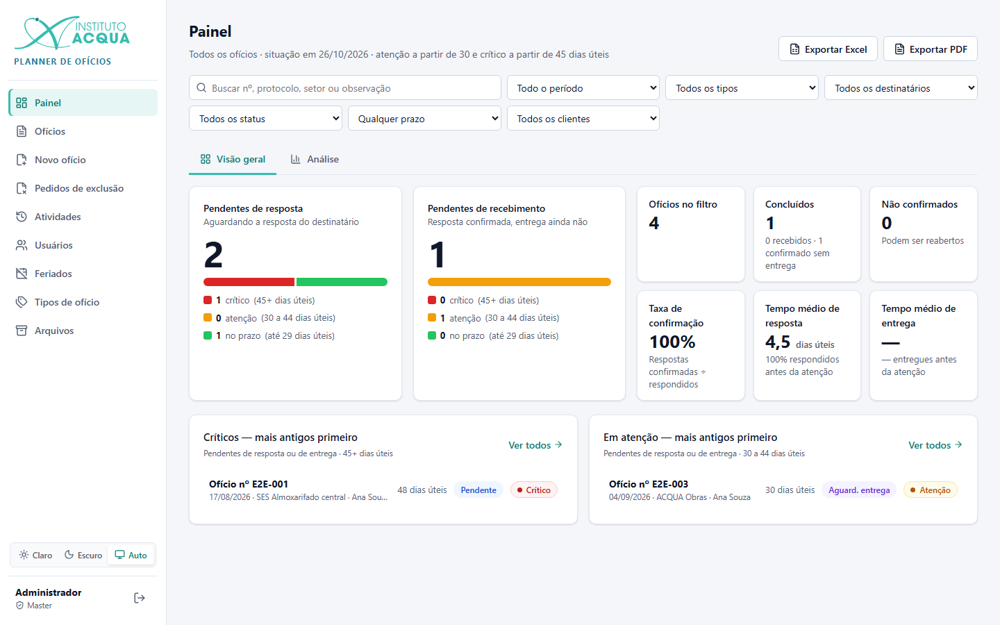
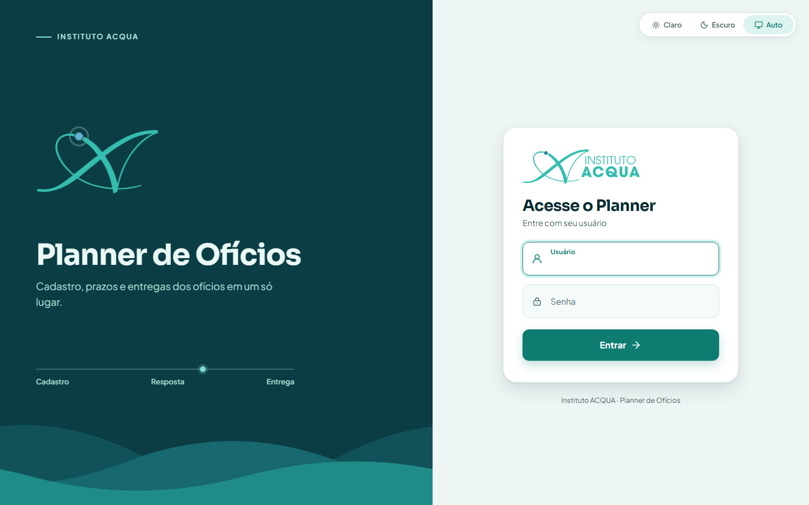
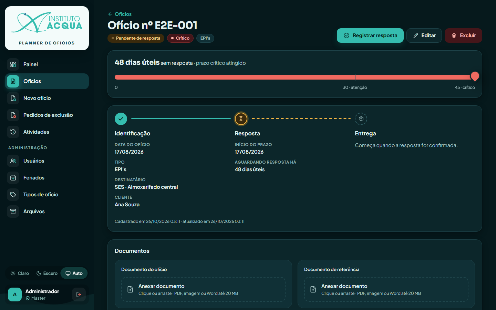
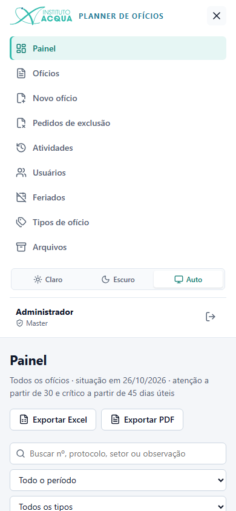

# Planner de Ofícios · Instituto ACQUA

Sistema web interno para cadastrar ofícios, guardar os documentos e acompanhar o prazo de resposta e de entrega em
**dias úteis**, com alertas de atenção e crítico, painel de indicadores e registro de tudo o que foi alterado.



## O que ele faz

- **Cadastro de ofícios:** número, data, tipo, destinatário (SES, ACQUA ou outro, com setor), protocolo, observação,
  o documento do ofício e um documento de referência.
- **Prazo em dias úteis:** conta de segunda a sexta, sem os feriados cadastrados. Com os limites padrão, o ofício fica
  *em atenção* com 30 dias úteis e *crítico* com 45.
- **Caminho do ofício:** pendente de resposta → resposta confirmada → (se o tipo exigir) pendente de recebimento →
  recebido. Uma resposta não confirmada pode ser reaberta, e o prazo reinicia.
- **Evidências:** documento da resposta e comprovante de entrega, ligados ao evento do histórico.
- **Painel:**
  - etapas pendentes, indicadores, filas de críticos e em atenção, gráficos e tabelas;
  - filtros por período, tipo, destinatário, status, prazo e cliente;
  - exportação em **Excel** (com gráficos) e **PDF**.
- **Perfis:** cliente (só os próprios ofícios), administrador e master. Clientes pedem a exclusão de um ofício e um
  administrador aprova ou recusa.
- **Segurança dos arquivos:**
  - **lixeira:** um documento substituído ou removido pode ser restaurado;
  - **verificação diária:** confere se cada arquivo existe e não foi alterado, pelo hash SHA-256 guardado no envio.
- **Atividades:** toda alteração fica registrada com quem fez, quando e o valor antigo → novo.
- **Visual:**
  - identidade do Instituto ACQUA, com tema claro, escuro ou automático;
  - ícones animados e login animado;
  - funciona no celular.

| Login | Tela do ofício (tema escuro) | Celular |
|---|---|---|
|  |  |  |

## Tecnologias

| Parte | Tecnologias |
|---|---|
| Back-end | Python 3.12+, FastAPI, SQLAlchemy 2, Alembic, Pydantic, PyJWT, openpyxl (Excel), ReportLab (PDF) |
| Banco | MySQL 8.4. Os testes usam SQLite em memória |
| Front-end | React 19, TypeScript, Vite, TanStack Query, React Router, lucide-react e ícones próprios |
| Testes | pytest (API) e Playwright (telas, no Microsoft Edge) |

A API também entrega as telas: depois de `npm run build`, um único processo (`python -m app`) responde em
`http://<máquina>:3112`.

## Começo rápido

Pré-requisitos: Python 3.12+, Node 20+ e um MySQL 8 (Docker: `docker compose up -d`).

```powershell
# Back-end
cd backend
python -m venv .venv
.venv\Scripts\activate
pip install -r requirements.txt
copy .env.example .env          # ajuste DATABASE_URL e gere uma JWT_SECRET própria
alembic upgrade head            # cria as tabelas
python -m scripts.inicializar   # cria o primeiro administrador e os feriados nacionais

# Front-end
cd ..\frontend
npm install
npm run build

# Sobe o sistema
cd ..\backend
python -m app                   # http://localhost:3112 · API documentada em /docs
```

O passo a passo completo, com rede, firewall e o MySQL portátil sem administrador, está em
[docs/INSTALACAO.md](docs/INSTALACAO.md).

## Documentação

| Documento | Para quem | Conteúdo |
|---|---|---|
| [Manual do usuário](docs/MANUAL.md) | Quem usa o sistema | Telas, perfis e o passo a passo de cada tarefa |
| [Regras de negócio](docs/REGRAS.md) | Todos | Prazos, status, entrega, anexos, perfis, correções e exclusões |
| [Instalação e operação](docs/INSTALACAO.md) | Quem mantém o servidor | Instalar, configurar (`.env`), ligar, rede, backup, atualizações, feriados |
| [Arquitetura](docs/ARQUITETURA.md) | Desenvolvedores | Estrutura, modelo de dados, fluxo de status, segurança, visual |
| [API](docs/API.md) | Desenvolvedores | Todos os endpoints, com perfil exigido |
| [Desenvolvimento](docs/DESENVOLVIMENTO.md) | Desenvolvedores | Ambiente, testes, migrações, convenções |

## Versões do visual

| Ramo | Visual | Quando usar |
|---|---|---|
| `main` | "Correnteza": menu verde-petróleo, ícones e login animados, fontes próprias | Computadores com folga de processamento |
| `visual-classico` | Visual original, **sem nenhuma animação** nem transição, fontes do sistema | Computadores mais simples; é o que está no ar hoje |

As telas, opções e regras são as mesmas nos dois. Para trocar o visual do sistema no ar, mude de ramo e gere o build
das telas (não precisa reiniciar a API):

```powershell
git checkout visual-classico   # ou: git checkout main
cd frontend
npm install
npm run build                  # depois, Ctrl+F5 no navegador
```

## Estrutura

```
backend/              API FastAPI (também serve frontend/dist)
  app/                models, schemas, routers, services
  alembic/            migrações do banco (0001 … 0010)
  scripts/            inicializar.py (1º admin + feriados), definir_perfil.py
  tests/              testes da API (pytest, SQLite em memória)
  tests_e2e/          testes de tela (Playwright)
frontend/             React + TypeScript (Vite)
  src/                api, auth, components, pages, styles, utils
docs/                 documentação e capturas de tela
iniciar.bat / parar.bat   ligam e desligam o MySQL portátil e o sistema no Windows
docker-compose.yml    MySQL 8.4 isolado (alternativa com Docker)
```

## Testes

```powershell
cd backend
.venv\Scripts\python -m pytest              # API: 62 testes, não precisam do MySQL
.venv\Scripts\python -m pytest tests_e2e    # telas: 9 fluxos no Edge (compile o front antes)
```

## Licença

Uso interno do Instituto ACQUA. O repositório é privado.
