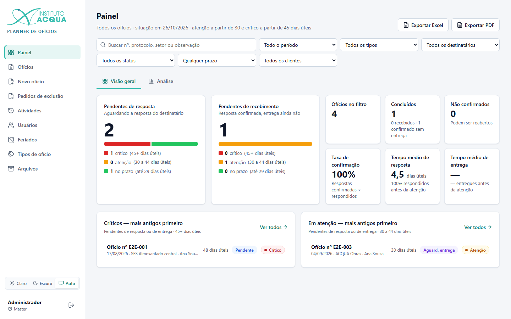
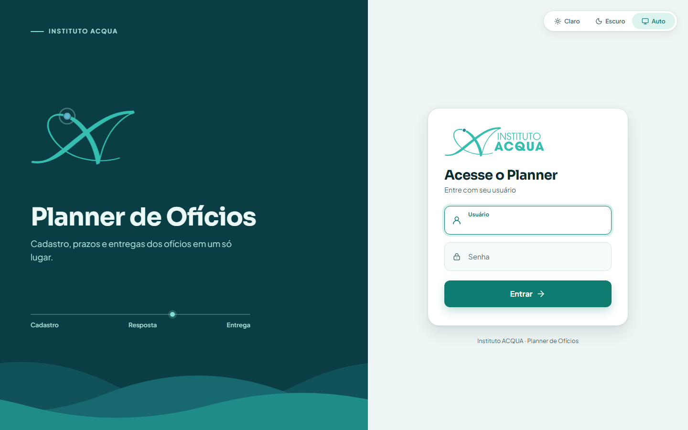
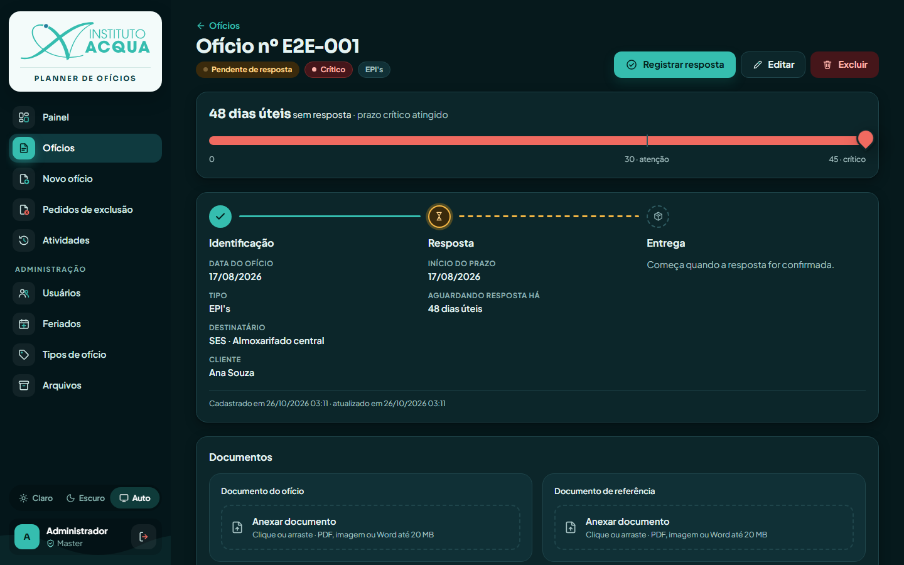
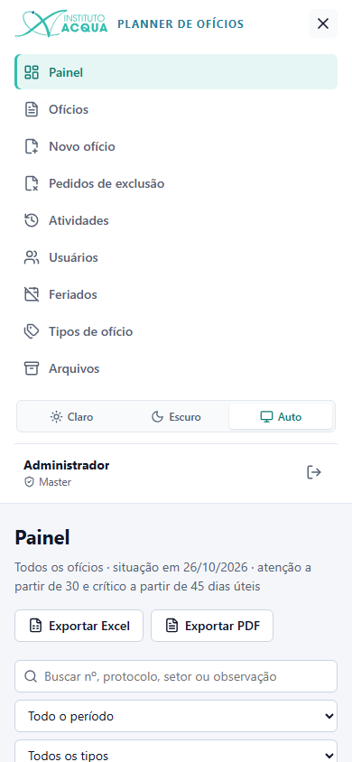

# Planner de Ofícios · Instituto ACQUA

Sistema web interno organizado em **módulos**, com um login só:

- **Planner de Ofícios:** cadastra ofícios, guarda os documentos e acompanha o prazo de resposta e de entrega em
  **dias corridos**, com alertas de atenção e crítico, painel de indicadores e registro de tudo o que foi alterado.
- **Manutenção Clínica:** helpdesk em que o operacional abre chamados para as empresas técnicas (MSI, Realiza Predial,
  Realiza Climatização…), com diagnóstico em **24 horas corridas**, relatório técnico, quadro de acompanhamento e
  solicitação de peças que vira um ofício no Planner.
- **Controle de Tetos:** cada setor tem tipos de teto (dinheiro ou outra unidade: litros, resmas, kWh…) definidos pelo
  administrador. O setor lança os gastos e acompanha o consumo do dia, do mês e do ano, com alerta, projeção do mês e
  gráficos dia a dia, mês a mês e ano a ano.

O que mudou em cada versão está em [docs/ATUALIZACOES.md](docs/ATUALIZACOES.md).



## Módulos e perfis

- Depois do login, a tela **Módulos** mostra só os módulos liberados para a pessoa (com um só, ela vai direto).
- O papel é **por módulo**: administrador ou cliente no Planner; administrador, operacional ou técnico na Manutenção;
  administrador ou usuário do setor (com o setor, ex.: joao.dantas · Gerência Operacional) no Controle de Tetos.
  O **master** administra todos.
- O master cadastra e edita o acesso a todos os módulos. O administrador de um módulo só mexe no acesso a esse módulo.
- Todo **operacional** da Manutenção também usa o Planner (como cliente, ou o papel que tiver lá). O **técnico** só
  vê a Manutenção, e só os chamados da própria empresa.

## Manutenção Clínica

- **Chamado:** empresa técnica, título, descrição do problema, local, equipamento e data/hora da ocorrência.
- **Prazo de diagnóstico:** 24 horas corridas por empresa (ajustável), contadas da abertura. Situação ao vivo: no prazo, vencendo, atrasado, cumprido ou cumprido com atraso.
- **Diagnóstico técnico:** numa seção só do chamado, o técnico registra o **relatório externo** da empresa e/ou o
  **relatório técnico** no modelo do sistema (com PDF), com a data e a hora em que diagnosticou. Tudo pode ser
  editado depois no mesmo lugar, e cada alteração fica na linha do tempo.
- **Tempo de solução:** ao concluir, o chamado grava quanto demorou do diagnóstico à solução (em horas corridas).
- **Painel e quadro:** indicadores por empresa e um quadro por etapa (aguardando diagnóstico, em execução, aguardando
  peças, concluídos), atualizado a cada 30 segundos. O técnico tem o próprio painel.
- **Preventivas:** planos com a periodicidade de cada rotina, agenda, registro da realização com evidência e
  **ateste** de quem fiscaliza. Mostra o previsto x realizado por empresa.
- **Avisos:** as pendências de cada pessoa ficam dentro do sistema, com o número no menu (não há envio de e-mail).
- **Peças e equipamentos:** o operacional pede pelo chamado. O pedido vira um ofício no Planner, ligado ao chamado.
  Um ofício que já existe no Planner também pode ser vinculado ao chamado.
  Os documentos são anexados no Planner, e tudo o que acontece com o ofício aparece na linha do tempo do chamado.

## Planner de Ofícios

- **Cadastro de ofícios:** número, data, tipo, destinatário (SES, ACQUA ou outro, com setor), protocolo, observação,
  o documento do ofício e um documento de referência.
- **Prazo em dias corridos:** conta todos os dias desde a data do ofício (ou da resposta, na etapa de entrega). Com
  os limites padrão, o ofício fica *em atenção* com 30 dias e *crítico* com 45.
- **Caminho do ofício:** pendente de resposta → resposta confirmada → (se o tipo exigir) pendente de recebimento →
  recebido. Uma resposta não confirmada pode ser reaberta, e o prazo reinicia.
- **Evidências:** documento da resposta e comprovante de entrega, ligados ao evento do histórico.
- **Painel:**
  - etapas pendentes, indicadores, filas de críticos e em atenção, gráficos e tabelas;
  - filtros por período, tipo, destinatário, status, prazo e cliente;
  - exportação em **Excel** (com gráficos) e **PDF**.
- **Perfis:** cliente (só os próprios ofícios), administrador e master. Clientes pedem a exclusão de um ofício e um
  administrador aprova ou recusa.
- **Segurança dos arquivos:**
  - **lixeira:** um documento substituído ou removido pode ser restaurado;
  - **verificação diária:** confere se cada arquivo existe e não foi alterado, pelo hash SHA-256 guardado no envio.
- **Integração com o módulo Documentos:** o ofício redigido lá pode entrar no Planner na emissão, com o PDF ligado a
  ele; quem tem o módulo vê o atalho *Redigir ofício* no menu.
- **Atividades:** toda alteração fica registrada com quem fez, quando e o valor antigo → novo.
- **Visual:**
  - identidade do Instituto ACQUA, com tema claro, escuro ou automático;
  - ícones animados e login animado;
  - funciona no celular.

| Login | Tela do ofício (tema escuro) | Celular |
|---|---|---|
|  |  |  |

## Tecnologias

| Parte | Tecnologias |
|---|---|
| Back-end | Python 3.12+, FastAPI, SQLAlchemy 2, Alembic, Pydantic, PyJWT, openpyxl (Excel), ReportLab (PDF) |
| Banco | MySQL 8.4. Os testes usam SQLite em memória |
| Front-end | React 19, TypeScript, Vite, TanStack Query, React Router, lucide-react e ícones próprios |
| Testes | pytest (API) e Playwright (telas, no Microsoft Edge) |

A API também entrega as telas: depois de `npm run build`, um único processo (`python -m app`) responde em
`http://<máquina>:3112`.

## Começo rápido

Pré-requisitos: Python 3.12+, Node 20+ e um MySQL 8 (Docker: `docker compose up -d`).

```powershell
# Back-end
cd backend
python -m venv .venv
.venv\Scripts\activate
pip install -r requirements.txt
copy .env.example .env          # ajuste DATABASE_URL e gere uma JWT_SECRET própria
alembic upgrade head            # cria as tabelas
python -m scripts.inicializar   # cria o primeiro administrador e os feriados nacionais

# Front-end
cd ..\frontend
npm install
npm run build

# Sobe o sistema
cd ..\backend
python -m app                   # http://localhost:3112 · API documentada em /docs
```

O passo a passo completo, com rede, firewall e o MySQL portátil sem administrador, está em
[docs/INSTALACAO.md](docs/INSTALACAO.md).

## Documentação

| Documento | Para quem | Conteúdo |
|---|---|---|
| [Atualizações](docs/ATUALIZACOES.md) | Todos | O que mudou em cada versão e como aplicar no servidor |
| [Manual do usuário](docs/MANUAL.md) | Quem usa o sistema | Telas, perfis e o passo a passo de cada tarefa |
| [Regras de negócio](docs/REGRAS.md) | Todos | Módulos e acessos, prazos, status, entrega, anexos, correções, exclusões e o helpdesk da Manutenção |
| [Instalação e operação](docs/INSTALACAO.md) | Quem mantém o servidor | Instalar, configurar (`.env`), ligar, rede, backup, atualizações, feriados |
| [Recursos de servidor](docs/RECURSOS-SERVIDOR.md) | Quem mantém o servidor | Processador, RAM, threads, disco e rede medidos, o servidor necessário e o custo de cada visual no navegador |
| [Arquitetura](docs/ARQUITETURA.md) | Desenvolvedores | Estrutura, modelo de dados, fluxo de status, segurança, visual |
| [API](docs/API.md) | Desenvolvedores | Todos os endpoints, com perfil exigido |
| [Desenvolvimento](docs/DESENVOLVIMENTO.md) | Desenvolvedores | Ambiente, testes, migrações, convenções |

## Versões e ramos

| Ramo | Versão | Módulos | Visual | Situação |
|---|---|---|---|---|
| `feature/2.3-controle-de-tetos` | 2.3 | Planner de Ofícios + Manutenção Clínica + Controle de Tetos + Documentos | "Correnteza" | Em homologação; parte da 2.2 |
| `feature/2.2-preventivas-prazos-diagnostico` | 2.2 | Planner de Ofícios + Manutenção Clínica, com preventivas | "Correnteza" | Em homologação; parte da 2.0 |
| `feature/modulos-manutencao-clinica` | 2.0 | Planner de Ofícios + Manutenção Clínica | "Correnteza" | Em homologação ([pull request #1](https://github.com/kimerainformatica/planner-de-oficios/pull/1)) |
| `main` | 1.1 | Planner de Ofícios | "Correnteza": menu verde-petróleo, ícones e login animados, fontes próprias | Estável, para computadores com folga de processamento |
| `visual-classico` | 1.1 | Planner de Ofícios | Clássico, **sem nenhuma animação** nem transição, fontes do sistema | Estável, para computadores mais simples; é o que está no ar hoje |

### Versões 2.0 a 2.3 (2.0 em `feature/modulos-manutencao-clinica`; 2.1 e 2.2 em `feature/2.2-preventivas-prazos-diagnostico`; 2.3 em `feature/2.3-controle-de-tetos`)

- **Módulos com um login só:** Planner de Ofícios e Manutenção Clínica, com o papel definido por módulo. Todo
  operacional da Manutenção também usa o Planner.
- **Manutenção Clínica (helpdesk):** chamados para MSI, Realiza Predial e Realiza Climatização, com diagnóstico em
  24 horas corridas. O técnico tem login próprio e responde com um relatório técnico em PDF. O sistema mostra o tempo de
  solução e um quadro de acompanhamento.
- **Peças e equipamentos:** o pedido feito no chamado vira um ofício no Planner. Os documentos são anexados no
  Planner, e o chamado acompanha cada passo.
- **Prazos em dias corridos e data do diagnóstico editável (2.2).**
- **Preventivas e avisos (2.1):** planos com periodicidade, registro com evidência, ateste e avisos internos.
- **Controle de Tetos (2.3):** setores ligados aos usuários, tipos de teto com valor por período e vigência,
  lançamentos com comprovante e indicadores diários, mensais e anuais.
- **Módulo Documentos (2.3):** ofícios e memorandos redigidos no app, no modelo da unidade (timbrado, Times New Roman
  12 no corpo, recuos do modelo), com número automático, código de verificação com QR code, assinatura à mão e/ou
  eletrônica no app e verificação pública. Integrado ao Planner: o ofício emitido pode entrar lá com os prazos.
- **Banco:** migrações 0011 a 0019.
- **Testes:** 138 testes da API.

A 2.0 entra no `main` depois da homologação. O `visual-classico` recebe a versão depois disso. O que mudou e como
aplicar no servidor está em [docs/ATUALIZACOES.md](docs/ATUALIZACOES.md).

### Custo de cada visual

O servidor consome o mesmo nas duas. No navegador, com a tela aberta e parada, a Correnteza usa de 17% a 50% de um
núcleo do processador por causa das animações em loop, e a Clássica usa de 2% a 15%. As telas compiladas da Clássica
são 24% menores (461 KB contra 606 KB). Medições completas em
[docs/RECURSOS-SERVIDOR.md](docs/RECURSOS-SERVIDOR.md#versões-do-visual-custo-no-computador-de-quem-usa).

### Trocar de ramo no servidor

Entre `main` e `visual-classico` as telas, opções e regras são as mesmas. Basta mudar de ramo e gerar o build das
telas, sem reiniciar a API:

```powershell
git checkout visual-classico   # ou: git checkout main
cd frontend
npm install
npm run build                  # depois, Ctrl+F5 no navegador
```

Para ir para a **2.0**, o banco também muda. Faça o backup, rode `alembic upgrade head` e reinicie o sistema. O passo
a passo está em [ATUALIZACOES.md](docs/ATUALIZACOES.md#como-aplicar-no-servidor). Depois da migração, voltar para a 1.1 exige
restaurar o backup do banco.

## Estrutura

```
backend/              API FastAPI (também serve frontend/dist)
  app/                models, schemas, routers, services
  alembic/            migrações do banco (0001 … 0019)
  scripts/            inicializar.py (1º admin + feriados), definir_perfil.py
  tests/              testes da API (pytest, SQLite em memória)
  tests_e2e/          testes de tela (Playwright)
frontend/             React + TypeScript (Vite)
  src/                api, auth, components, pages, styles, utils
docs/                 documentação e capturas de tela
iniciar.bat / parar.bat   ligam e desligam o MySQL portátil e o sistema no Windows
docker-compose.yml    MySQL 8.4 isolado (alternativa com Docker)
```

## Testes

```powershell
cd backend
.venv\Scripts\python -m pytest              # API: 138 testes, não precisam do MySQL
.venv\Scripts\python -m pytest tests_e2e    # telas: 9 fluxos no Edge (compile o front antes)
```

## Licença

Uso interno do Instituto ACQUA. O repositório é privado.
