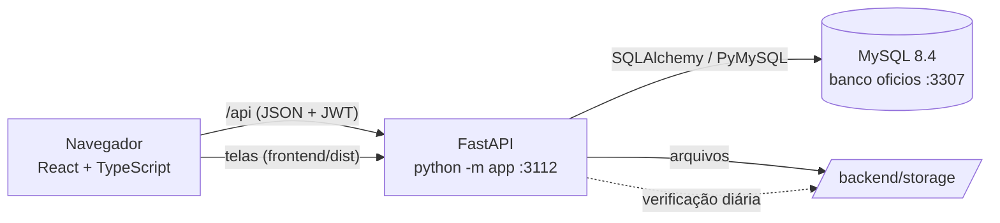
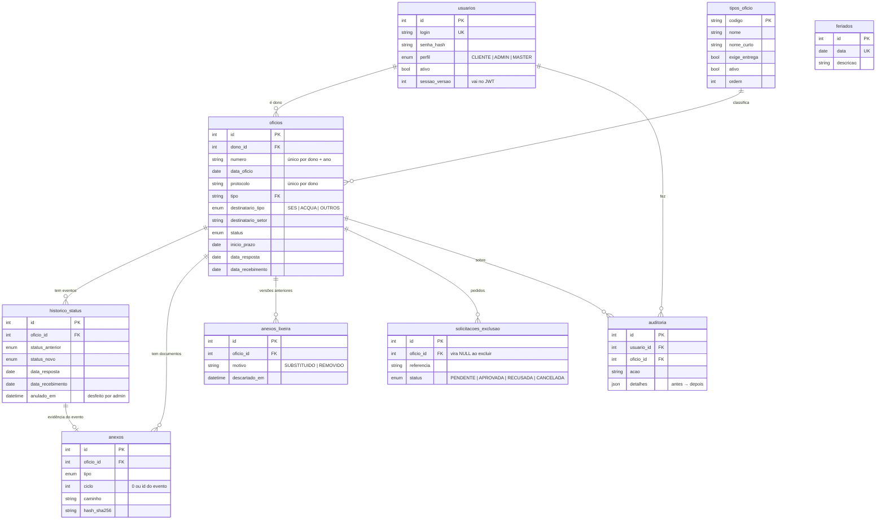

# Arquitetura

Visão técnica do Planner de Ofícios: como as partes se encaixam, onde fica cada regra e por quê.

## Visão geral

- **Um processo só:**
  - a API FastAPI responde em `/api/*`;
  - entrega as telas já compiladas (`frontend/dist`), com fallback para `index.html`, para que as rotas do React
    funcionem ao recarregar;
  - documenta a si mesma em `/docs` (Swagger).
- **Banco:** MySQL 8.4 em produção. Os testes da API usam SQLite em memória, e os testes de tela usam SQLite em
  arquivo temporário.
- **Arquivos:** ficam no disco (`STORAGE_DIR`) com nome aleatório. O banco guarda os metadados e o hash SHA-256.
- **Tarefa em segundo plano:** uma thread inicia a verificação dos arquivos 60 s depois de ligar e repete a cada
  `VERIFICACAO_HORAS`. Ela só existe quando o sistema sobe por `python -m app`, nunca nos testes.

## Back-end (`backend/app`)

| Arquivo / pasta | Papel |
|---|---|
| `__main__.py` | Ponto de entrada: configura o log, recusa subir na rede com a `JWT_SECRET` padrão, agenda a verificação e chama o uvicorn |
| `main.py` | Cria o app FastAPI, registra os routers, o CORS e o serviço das telas |
| `config.py` | Configuração (`pydantic-settings`, lê `backend/.env`) |
| `database.py` | Engine e sessão do SQLAlchemy |
| `models.py` | Tabelas (SQLAlchemy 2, `Mapped`) |
| `schemas.py` | Entrada e saída da API (Pydantic v2) |
| `seguranca.py` | Hash de senha (PBKDF2-SHA256, 600 mil iterações) e JWT (HS256) |
| `deps.py` | Dependências: sessão do banco, usuário atual (valida o token e a `sessao_versao`), exigência de admin ou master |
| `routers/` | Uma rota por assunto: `auth`, `usuarios`, `oficios`, `anexos`, `lixeira` (com a verificação), `tipos`, `dashboard`, `feriados`, `exclusoes`, `auditoria` |
| `services/` | Regras de negócio, sem HTTP (veja abaixo) |

### Serviços

| Serviço | Responsabilidade |
|---|---|
| `prazos.py` | Dias úteis entre datas (sem fins de semana e feriados), nível de alerta e feriados nacionais (inclui a Páscoa móvel) |
| `oficios.py` | Transições de status, etapa de recebimento, reabertura, correções, desfazer e ajuste quando o tipo muda |
| `tipos.py` | Tipos iniciais, validação do tipo de um ofício e `exige_recebimento` |
| `armazenamento.py` | Gravação dos arquivos (nome aleatório, hash, limite de tamanho e extensões) e envio para a lixeira |
| `integridade.py` | Verificação dos arquivos (existe? mesmo hash?) e agendamento |
| `limite_login.py` | Contagem de senhas erradas por login + IP e bloqueio temporário (em memória) |
| `analise.py` | Indicadores e agrupamentos do painel. É a mesma rotina para a tela, o Excel e o PDF |
| `exportacao.py` | Gera o Excel (openpyxl, com gráficos nativos) e o PDF (ReportLab) |
| `exclusoes.py` | Exclusão de ofício com remoção dos arquivos, inclusive os da lixeira |
| `auditoria.py` | Registro de atividades (ação, descrição, antes → depois) e os nomes legíveis das ações |

## Modelo de dados

Decisões importantes:

- **O alerta não fica gravado:** é calculado na hora a partir de `inicio_prazo` (ou `data_resposta`, na etapa de
  entrega) e dos feriados. Assim, mudar um feriado ou os limites vale na hora para todos os ofícios.
- **Unicidade por dono:** `(dono_id, numero, ano)` e `(dono_id, protocolo)`. Clientes diferentes podem repetir
  números.
- **Um anexo por vaga:** `(oficio_id, tipo, ciclo)` é único. Documento do ofício e de referência usam `ciclo = 0`.
  Uma evidência usa o `id` do evento do histórico.
- **O histórico nunca é apagado** pelas correções: `anulado_em`, `anulado_por_id` e `anulado_motivo` marcam o que
  foi desfeito.
- **Auditoria legível depois de exclusões:** a auditoria e os pedidos guardam uma `referencia` em texto, e as chaves
  estrangeiras viram `NULL` quando o ofício é excluído.
- **Tipos como tabela:** os tipos viraram tabela na migração 0009. O ofício aponta para `tipos_oficio.codigo` com
  `ON DELETE RESTRICT`, então um tipo em uso não se apaga.

### Migrações (`backend/alembic/versions`)

| Nº | Conteúdo |
|---|---|
| 0001 | Estrutura inicial |
| 0002 | Tipo, destinatário e evidência da resposta |
| 0003 | Perfil master, pedidos de exclusão e auditoria |
| 0004 | Tipos Peças e Mobiliários |
| 0005 | Etapa de recebimento |
| 0006 | Correções dos administradores (desfazer) |
| 0007 | Entrega para Serviços e Outros |
| 0008 | Lixeira de anexos |
| 0009 | Tipos cadastráveis (tabela `tipos_oficio`) |
| 0010 | `sessao_versao` (trocar a senha encerra as sessões) |

## Segurança

| Tema | Como é tratado |
|---|---|
| Senhas | PBKDF2-SHA256 com sal aleatório e 600 mil iterações. A senha nunca é guardada nem registrada em log |
| Sessão | JWT HS256 com validade de `JWT_EXPIRA_MINUTOS`. O token leva o id, o perfil e a `sessao_versao`; trocar a senha incrementa a versão e invalida os tokens antigos |
| Chave | O sistema se recusa a subir na rede com a `JWT_SECRET` padrão ou curta |
| Força bruta | 5 senhas erradas seguidas por login + IP → HTTP 429 por 5 minutos (configurável) |
| Autorização | Cada rota verifica o perfil. O cliente só enxerga os próprios ofícios (filtro no back-end, não na tela) |
| Arquivos | Extensões permitidas, tamanho máximo, nome aleatório no disco (o nome original fica só no banco), hash SHA-256 conferido diariamente, pasta `storage` com permissões do Windows restritas |
| CORS | Liberado para `localhost` e as faixas de rede interna (10.x, 172.16–31.x, 192.168.x), além de `CORS_ORIGINS` |
| Banco | Usuário próprio com acesso só ao banco `oficios`. O MySQL portátil aceita conexões só da própria máquina |
| Segredos | `.env`, banco, documentos, logs e backups ficam fora do repositório (`.gitignore`) |

## Front-end (`frontend/src`)

| Pasta | Papel |
|---|---|
| `api/` | `client.ts` (fetch com token, erros em português, download de arquivos) e `endpoints.ts` (uma função tipada por rota) |
| `auth/` | `AuthContext`: login, usuário atual, perfil, saída automática quando o token expira |
| `components/` | Layout (menu), gráficos SVG (`graficos.tsx`), campos do ofício, upload, lixeira, seletor de tema, toasts, modal e badges (`ui.tsx`) |
| `pages/` | Uma tela por rota: Login, Painel, Ofícios, Novo ofício, Pedidos de exclusão, Atividades, Usuários, Feriados, Tipos de ofício, Arquivos |
| `pages/oficio/` | A tela do ofício, dividida em dados, anexos, histórico e janelas (resposta, correção, edição e exclusão) |
| `styles/` | CSS por assunto: `base` (cores, tipografia e o desligamento das animações), `layout`, `componentes`, `oficio`, `painel`, `admin`, `login` |
| `utils/` | Formatação (datas, dias úteis, rótulos), tema, tipos de ofício e download |

- **Dados:** TanStack Query, com cache, revalidação ao voltar para a aba e invalidação após cada alteração.
- **Rotas:** React Router. Os filtros do painel e da lista ficam no endereço, então podem ser compartilhados.
- **Gráficos:** SVG próprio, com cores validadas para daltonismo, tooltip, tabela alternativa e um eixo só.

### Visual clássico (ramo `visual-classico`)

Este ramo tem o visual original do sistema, sem animações, para pesar menos no computador. O visual animado
"Correnteza" está no ramo `main`. Os dois têm as mesmas telas, opções e regras.

- **Cores:** variáveis CSS em `styles/base.css`.
  - Identidade ACQUA: verde-água `#35bdaf` e azul-petróleo `#257e9c`.
  - Primária `#0f7c72`, para o texto branco ter contraste.
  - Menu lateral claro, com o logo no topo.
- **Tema:** `data-theme="light|dark"` no `<html>`. Um script em `index.html` aplica o tema antes de desenhar a
  página, e o hook `utils/tema.ts` guarda a escolha em `localStorage` (`planner-tema`).
- **Fontes e ícones:** as fontes do sistema (Segoe UI no Windows), sem download, e os ícones do lucide-react.
- **Sem movimento:** uma regra em `styles/base.css` desliga toda animação e transição
  (`animation: none` e `transition: none` em todos os elementos). O "Carregando…" aparece com um ícone parado.
