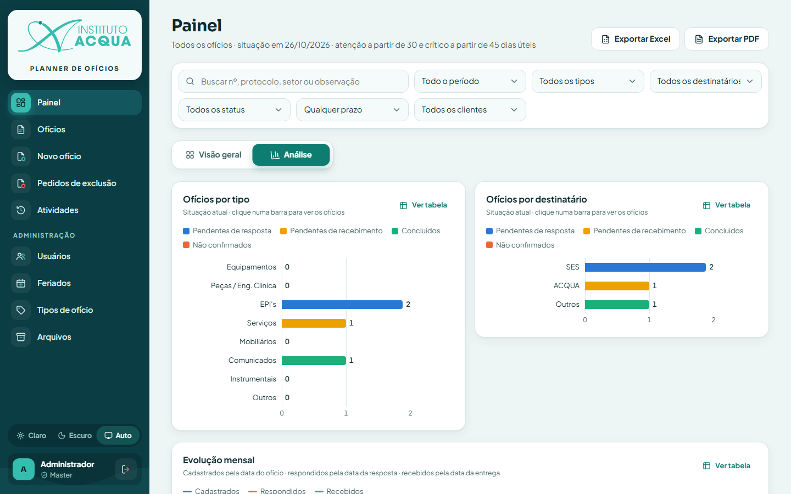
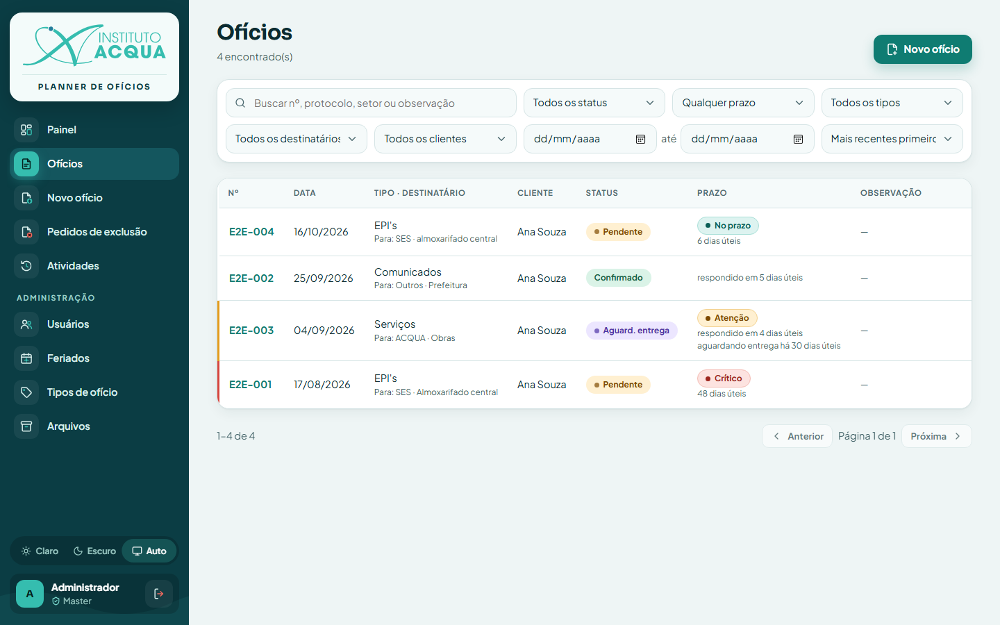
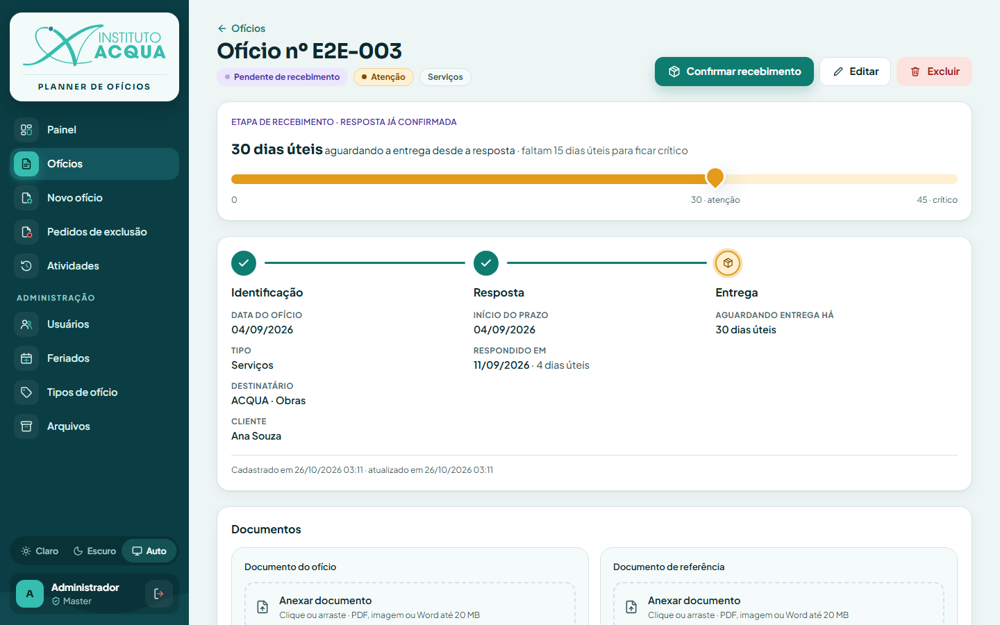
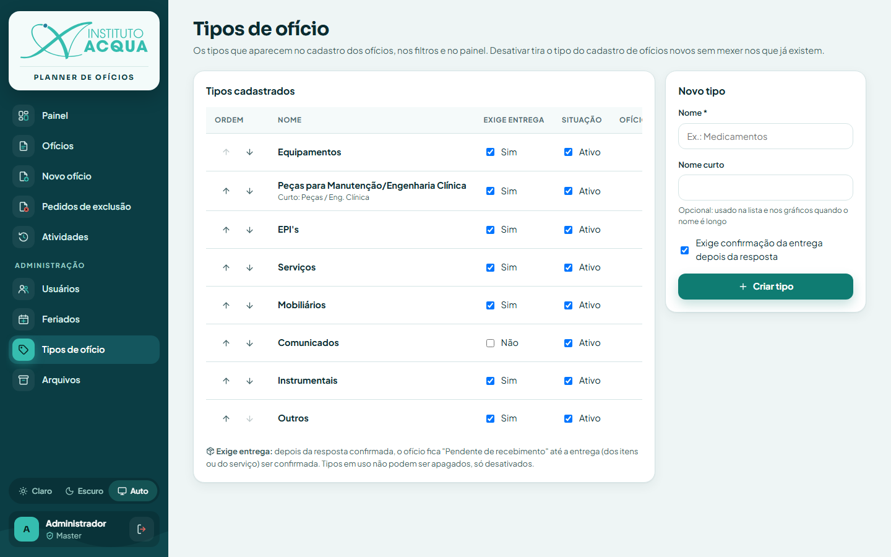
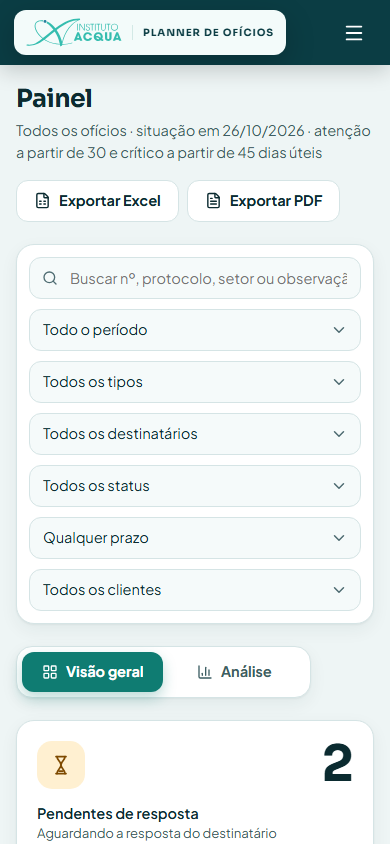

# Manual do usuário

Como usar o Planner de Ofícios no dia a dia. As regras por trás de cada tela estão em [REGRAS.md](REGRAS.md).

## Entrar

1. Abra o endereço do sistema no navegador. Nesta rede, ele é mostrado ao ligar o sistema, por exemplo
   `http://192.168.70.198:3112`.
2. Digite **Usuário** e **Senha** e clique em **Entrar**.

- **Tema:** no alto da tela você escolhe **Claro**, **Escuro** ou **Auto** (segue o tema do computador). A escolha
  fica guardada naquele navegador.
- **Senha errada:** depois de 5 senhas erradas seguidas, o login fica bloqueado por 5 minutos naquele computador.
- **Sessão encerrada:** se aparecer "Sua sessão foi encerrada", a senha foi trocada ou o tempo de acesso (8 horas)
  acabou. Basta entrar de novo.

## O menu

O menu fica à esquerda. No celular, ele abre pelo botão ☰ no alto.

| Item | Quem vê | Para quê |
|---|---|---|
| Painel | Todos | Situação geral, prazos, gráficos e exportação |
| Ofícios | Todos | Lista com busca e filtros |
| Novo ofício | Todos | Cadastrar um ofício |
| Pedidos de exclusão | Todos | Cliente: os pedidos que fez. Administrador: os pedidos a decidir (com contador) |
| Atividades | Todos | Tudo o que foi alterado, por quem e quando |
| Usuários | Administrador e master | Criar e alterar contas |
| Feriados | Administrador e master | Dias que não contam no prazo |
| Tipos de ofício | Administrador e master | Os tipos e se exigem entrega |
| Arquivos | Administrador e master | Verificação dos documentos e lixeira (com contador de problemas) |

No pé do menu ficam o seletor de tema, o seu nome, o seu perfil e o botão **Sair**.

## Painel

### Visão geral

- **Pendentes de resposta** e **Pendentes de recebimento:** quantos ofícios estão em cada etapa e quantos estão
  críticos, em atenção ou no prazo. Clique no número ou num dos níveis para abrir a lista já filtrada.
- **Indicadores:** ofícios no filtro, concluídos, não confirmados, taxa de confirmação e tempos médios de resposta e
  de entrega, em dias úteis.
- **Críticos** e **Em atenção:** os mais antigos primeiro. Clique para abrir o ofício.

### Análise

Gráficos de ofícios por tipo e por destinatário, evolução mensal, tempos médios por tipo, principais setores e
destinos, e uma tabela por cliente. Cada gráfico tem o botão **Ver tabela**. Clicar numa barra abre os ofícios
correspondentes.

### Filtros e exportação

- **Filtros:** busca (número, protocolo, setor ou observação), período, tipo, destinatário, status, prazo e cliente
  (só administrador). Valem para as duas abas. **Limpar filtros** volta ao início.
- **Exportar Excel** e **Exportar PDF** geram o relatório com os mesmos filtros: indicadores, gráficos e a lista de
  ofícios.
- O endereço da página guarda os filtros, então dá para salvar nos favoritos ou mandar o link para alguém.

## Lista de ofícios

- **Busca e filtros:** status, prazo, tipo, destinatário, data do ofício (de / até) e ordem (mais recentes ou mais
  antigos primeiro).
- **Colunas:** número, data, tipo e destinatário, status, prazo, observação, anexos e cliente (para administradores).
- **Abrir:** clique na linha. No celular, a tabela vira uma lista de cartões.

## Cadastrar um ofício

Em **Novo ofício**:

1. **Número do ofício** e **Data do ofício** (obrigatórios).
2. **Tipo de ofício** (obrigatório). O tipo define se haverá a etapa de entrega.
3. **Destinatário** (opcional): SES, ACQUA ou Outros, e o setor ou destino. Ao digitar, aparecem os setores já
   usados.
4. **Protocolo** e **Observação** (opcionais).
5. **Anexar o ofício** e **Anexar referência** (opcionais): clique ou arraste o arquivo (PDF, imagem ou Word, até
   20 MB).
6. Administradores escolhem também o **Cliente** dono do ofício.
7. Clique em **Cadastrar ofício**. O ofício entra como **Pendente de resposta**.

## Tela do ofício

- **Cabeçalho:** número, status, nível de prazo e tipo. Os botões mudam conforme a etapa:

  | Situação | Botão principal |
  |---|---|
  | Pendente de resposta | **Registrar resposta** |
  | Pendente de recebimento | **Confirmar recebimento** |
  | Não confirmado | **Reabrir** |

  Também ficam no cabeçalho **Editar** e **Excluir**. Para clientes, o segundo é **Solicitar exclusão**.
- **Barra do prazo** (só pendentes): quantos dias úteis se passaram e quanto falta para entrar em atenção ou ficar
  crítico. A marca no meio é o limite de atenção, e o fim da barra é o crítico.
- **Caminho:** Identificação → Resposta → Entrega. Etapa concluída aparece com ✓, a etapa atual pulsa e a futura é
  tracejada. Cada bloco mostra os dados daquela etapa.
- **Documentos:** documento do ofício, documento de referência e, quando houver, evidência da resposta e da
  entrega. Cada um pode ser **visualizado**, **baixado** e **substituído**. Administradores também podem **remover**.
- **Versões anteriores na lixeira** (administradores): os documentos substituídos ou removidos deste ofício.
- **Histórico:** cada passo do ofício, com data, autor, observação e evidência. **Mostrar eventos desfeitos** exibe
  as correções.
- **Registro de alterações:** a auditoria completa do ofício (quem mudou o quê). Abre ao clicar.

### Registrar a resposta

1. Clique em **Registrar resposta**.
2. Escolha **Confirmado** ou **Não confirmado**. A janela avisa se o tipo exige entrega.
3. Informe a **data da resposta** e, se quiser, anexe o documento de resposta e escreva uma observação.
4. Clique em **Registrar**.

O resultado depende da escolha e do tipo:
- Confirmado, num tipo que exige entrega: vai para **Pendente de recebimento**.
- Confirmado, num tipo sem entrega: vai para **Confirmado**.
- Não confirmado: vai para **Não confirmado**.

### Confirmar o recebimento

1. Clique em **Confirmar recebimento**.
2. Informe a data da entrega e, se quiser, anexe o comprovante (canhoto, termo de recebimento, relatório do
   serviço…).

O ofício passa a **Recebido**.

### Reabrir

Num ofício **Não confirmado**, **Reabrir** o devolve a **Pendente de resposta** e o prazo recomeça a contar.

### Correções (administradores)

No histórico, os administradores têm:
- **Corrigir resposta**: resultado, data e observação;
- **Corrigir recebimento**: data e observação;
- **Desfazer**: informando o motivo.

O que foi desfeito continua no histórico, riscado.

### Excluir

- **Administrador:** **Excluir** pede confirmação e apaga o ofício e os documentos.
- **Cliente:** **Solicitar exclusão** pede um motivo. O ofício mostra um aviso até um administrador decidir, e o
  cliente pode cancelar o pedido.

## Pedidos de exclusão

- **Administrador:** vê os pedidos pendentes e o histórico de decisões. Pode **Aprovar e excluir** ou **Recusar**,
  informando um motivo.
- **Cliente:** acompanha os próprios pedidos.

## Atividades

Lista de tudo o que foi feito, filtrável por tipo de atividade e período. Clique numa linha para ver os detalhes
(valor antigo → novo). Clientes veem o que fizeram e o que aconteceu nos próprios ofícios.

## Administração

### Usuários

- **Novo usuário:** nome, login, senha (mínimo de 8 caracteres) e perfil (cliente, administrador ou master; só o
  master cria administradores e masters).
- **Editar:** altera nome, perfil, situação (ativo ou inativo) e senha. Deixe a senha em branco para manter a atual.
  Trocar a senha encerra as sessões abertas daquela pessoa.

### Feriados

- Navegue pelos anos com as setas.
- **Cadastrar nacionais de {ano}** adiciona os feriados nacionais.
- **Adicionar feriado** cadastra feriados locais ou pontos facultativos (data e descrição).
- Lembre de cadastrar os feriados de cada ano novo.

### Tipos de ofício

- **Ordem:** as setas definem a ordem nas listas e nos gráficos.
- **Exige entrega:** ao marcar ou desmarcar, o sistema avisa e ajusta os ofícios já respondidos daquele tipo.
- **Situação:** um tipo desativado some do cadastro de ofícios novos.
- **Editar:** muda o nome e o nome curto.
- **Apagar:** só aparece em tipos que nunca foram usados.
- **Novo tipo:** nome, nome curto (opcional) e se exige entrega.

### Arquivos

- **Verificação dos arquivos:** mostra quantos documentos foram conferidos e se algum **sumiu** ou foi **alterado**,
  com o link para o ofício. **Verificar agora** refaz a verificação. Ela também roda sozinha uma vez por dia.
- **Lixeira:** as versões anteriores de todos os ofícios, com **Visualizar**, **Baixar**, **Restaurar** e
  **Apagar de vez**.

Se um arquivo sumir ou for alterado, recupere-o do backup da pasta `backend/storage` ou envie de novo no ofício.

## Celular

O sistema funciona no navegador do celular: o menu abre pelo botão ☰ e as tabelas viram listas.

| Painel | Menu |
|---|---|
|  |  |
