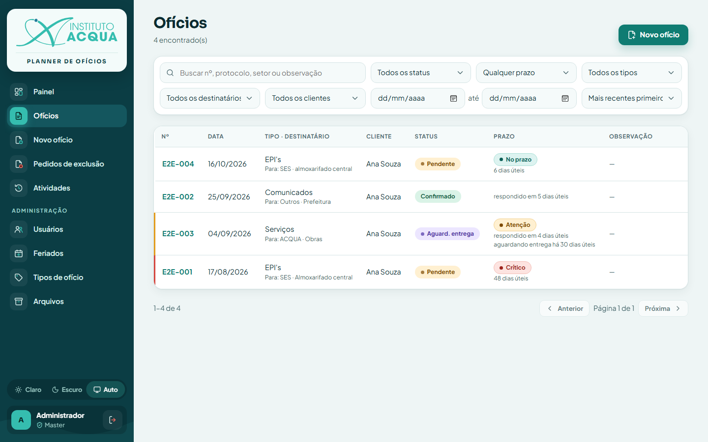
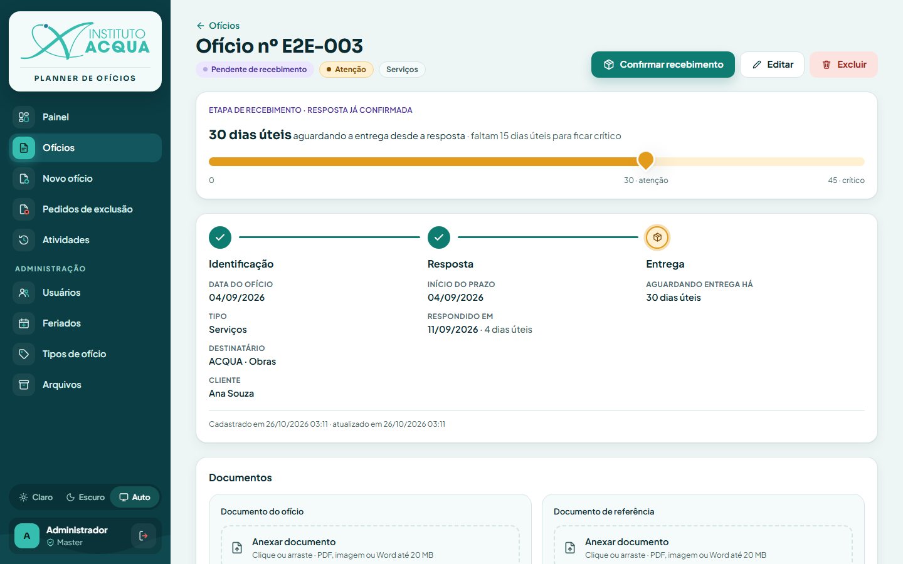
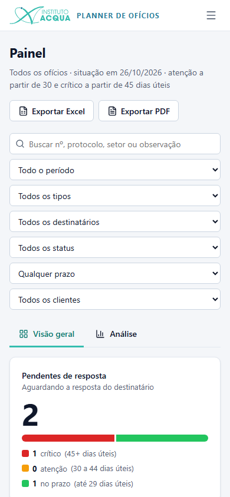

# Manual do usuário

Como usar o sistema no dia a dia: o Planner de Ofícios e, no fim, a [Manutenção Clínica](#manutenção-clínica). As
regras por trás de cada tela estão em [REGRAS.md](REGRAS.md).

## Entrar

1. Abra o endereço do sistema no navegador. Nesta rede, ele é mostrado ao ligar o sistema, por exemplo
   `http://192.168.70.198:3112`.
2. Digite **Usuário** e **Senha** e clique em **Entrar**.

- **Tema:** no alto da tela você escolhe **Claro**, **Escuro** ou **Auto** (segue o tema do computador). A escolha
  fica guardada naquele navegador.
- **Senha errada:** depois de 5 senhas erradas seguidas, o login fica bloqueado por 5 minutos naquele computador.
- **Sessão encerrada:** se aparecer "Sua sessão foi encerrada", a senha foi trocada ou o tempo de acesso (8 horas)
  acabou. Basta entrar de novo.

## O menu

O menu fica à esquerda. No celular, ele abre pelo botão ☰ no alto.

| Item | Quem vê | Para quê |
|---|---|---|
| Painel | Todos | Situação geral, prazos, gráficos e exportação |
| Ofícios | Todos | Lista com busca e filtros |
| Novo ofício | Todos | Cadastrar um ofício |
| Pedidos de exclusão | Todos | Cliente: os pedidos que fez. Administrador: os pedidos a decidir (com contador) |
| Atividades | Todos | Tudo o que foi alterado, por quem e quando |
| Usuários | Administrador e master | Criar e alterar contas |
| Tipos de ofício | Administrador e master | Os tipos e se exigem entrega |
| Arquivos | Administrador e master | Verificação dos documentos e lixeira (com contador de problemas) |

No pé do menu ficam o seletor de tema, o seu nome, o seu perfil e o botão **Sair**.

## Painel

### Visão geral

- **Pendentes de resposta** e **Pendentes de recebimento:** quantos ofícios estão em cada etapa e quantos estão
  críticos, em atenção ou no prazo. Clique no número ou num dos níveis para abrir a lista já filtrada.
- **Indicadores:** ofícios no filtro, concluídos, não confirmados, taxa de confirmação e tempos médios de resposta e
  de entrega, em dias corridos.
- **Críticos** e **Em atenção:** os mais antigos primeiro. Clique para abrir o ofício.

### Análise

Gráficos de ofícios por tipo e por destinatário, evolução mensal, tempos médios por tipo, principais setores e
destinos, e uma tabela por cliente. Cada gráfico tem o botão **Ver tabela**. Clicar numa barra abre os ofícios
correspondentes.

### Filtros e exportação

- **Filtros:** busca (número, protocolo, setor ou observação), período, tipo, destinatário, status, prazo e cliente
  (só administrador). Valem para as duas abas. **Limpar filtros** volta ao início.
- **Exportar Excel** e **Exportar PDF** geram o relatório com os mesmos filtros: indicadores, gráficos e a lista de
  ofícios.
- O endereço da página guarda os filtros, então dá para salvar nos favoritos ou mandar o link para alguém.

## Lista de ofícios

- **Busca e filtros:** status, prazo, tipo, destinatário, data do ofício (de / até) e ordem (mais recentes ou mais
  antigos primeiro).
- **Colunas:** número, data, tipo e destinatário, status, prazo, observação, anexos e cliente (para administradores).
- **Abrir:** clique na linha. No celular, a tabela vira uma lista de cartões.

## Cadastrar um ofício

Em **Novo ofício**:

1. **Número do ofício** e **Data do ofício** (obrigatórios).
2. **Tipo de ofício** (obrigatório). O tipo define se haverá a etapa de entrega.
3. **Destinatário** (opcional): SES, ACQUA ou Outros, e o setor ou destino. Ao digitar, aparecem os setores já
   usados.
4. **Protocolo** e **Observação** (opcionais).
5. **Anexar o ofício** e **Anexar referência** (opcionais): clique ou arraste o arquivo (PDF, imagem ou Word, até
   20 MB).
6. Administradores escolhem também o **Cliente** dono do ofício.
7. Clique em **Cadastrar ofício**. O ofício entra como **Pendente de resposta**.

## Tela do ofício

- **Cabeçalho:** número, status, nível de prazo e tipo. Os botões mudam conforme a etapa:

  | Situação | Botão principal |
  |---|---|
  | Pendente de resposta | **Registrar resposta** |
  | Pendente de recebimento | **Confirmar recebimento** |
  | Não confirmado | **Reabrir** |

  Também ficam no cabeçalho **Editar** e **Excluir**. Para clientes, o segundo é **Solicitar exclusão**.
- **Barra do prazo** (só pendentes): quantos dias se passaram e quanto falta para entrar em atenção ou ficar
  crítico. A marca no meio é o limite de atenção, e o fim da barra é o crítico.
- **Caminho:** Identificação → Resposta → Entrega. Etapa concluída aparece com ✓, a etapa atual pulsa e a futura é
  tracejada. Cada bloco mostra os dados daquela etapa.
- **Documentos:** documento do ofício, documento de referência e, quando houver, evidência da resposta e da
  entrega. Cada um pode ser **visualizado**, **baixado** e **substituído**. Administradores também podem **remover**.
- **Versões anteriores na lixeira** (administradores): os documentos substituídos ou removidos deste ofício.
- **Histórico:** cada passo do ofício, com data, autor, observação e evidência. **Mostrar eventos desfeitos** exibe
  as correções.
- **Registro de alterações:** a auditoria completa do ofício (quem mudou o quê). Abre ao clicar.

### Registrar a resposta

1. Clique em **Registrar resposta**.
2. Escolha **Confirmado** ou **Não confirmado**. A janela avisa se o tipo exige entrega.
3. Informe a **data da resposta** e, se quiser, anexe o documento de resposta e escreva uma observação.
4. Clique em **Registrar**.

O resultado depende da escolha e do tipo:
- Confirmado, num tipo que exige entrega: vai para **Pendente de recebimento**.
- Confirmado, num tipo sem entrega: vai para **Confirmado**.
- Não confirmado: vai para **Não confirmado**.

### Confirmar o recebimento

1. Clique em **Confirmar recebimento**.
2. Informe a data da entrega e, se quiser, anexe o comprovante (canhoto, termo de recebimento, relatório do
   serviço…).

O ofício passa a **Recebido**.

### Reabrir

Num ofício **Não confirmado**, **Reabrir** o devolve a **Pendente de resposta** e o prazo recomeça a contar.

### Correções (administradores)

No histórico, os administradores têm:
- **Corrigir resposta**: resultado, data e observação;
- **Corrigir recebimento**: data e observação;
- **Desfazer**: informando o motivo.

O que foi desfeito continua no histórico, riscado.

### Excluir

- **Administrador:** **Excluir** pede confirmação e apaga o ofício e os documentos.
- **Cliente:** **Solicitar exclusão** pede um motivo. O ofício mostra um aviso até um administrador decidir, e o
  cliente pode cancelar o pedido.

## Pedidos de exclusão

- **Administrador:** vê os pedidos pendentes e o histórico de decisões. Pode **Aprovar e excluir** ou **Recusar**,
  informando um motivo.
- **Cliente:** acompanha os próprios pedidos.

## Atividades

Lista de tudo o que foi feito, filtrável por tipo de atividade e período. Clique numa linha para ver os detalhes
(valor antigo → novo). Clientes veem o que fizeram e o que aconteceu nos próprios ofícios.

## Administração

### Usuários

- **Novo usuário:** nome, login, senha (mínimo de 8 caracteres) e o **acesso aos módulos**:
  - Planner de Ofícios: *Sem acesso*, *Cliente* ou *Administrador*;
  - Manutenção Clínica: *Sem acesso*, *Operacional*, *Técnico* (escolha também a empresa) ou *Administrador*;
  - Documentos: *Sem acesso*, *Redator* ou *Administrador*.

  Só o master cria administradores e masters. Um administrador só habilita pessoas nos módulos que ele administra.
- **Operacional sempre tem o Planner:** ao escolher *Operacional* ou *Administrador* na Manutenção, o Planner vem
  como *Cliente* (ou mantém o papel que a pessoa já tinha) e a opção *Sem acesso* some. O técnico fica só na
  Manutenção.
- **Cargo e matrícula/ID:** saem no bloco de assinatura dos documentos (ofícios e memorandos).
- **Editar:** altera nome, login, situação (ativo ou inativo), senha e o acesso aos módulos. Deixe a senha em branco
  para manter a atual. Trocar a senha encerra as sessões abertas daquela pessoa. O administrador de um módulo só
  altera o nome, o login, a senha e a situação de quem usa apenas módulos que ele administra.
- **Depois do login:** quem tem acesso a mais de um módulo (o master, por exemplo) escolhe o módulo na tela
  **Módulos**. Quem tem só um módulo entra direto nele.

### Timbrado (módulo Documentos)

Em **Documentos → Timbrado** (administrador do módulo): o cabeçalho (logotipos, endereço e telefones) e a marca-d'água
de todos os ofícios e memorandos. Envie as imagens em
PNG ou JPG; para mudar o endereço ou o telefone, basta trocar o cabeçalho. A cidade da linha de data vem do servidor
(`DOCUMENTOS_CIDADE` e `DOCUMENTOS_UF`).

### Tipos de ofício

- **Ordem:** as setas definem a ordem nas listas e nos gráficos.
- **Exige entrega:** ao marcar ou desmarcar, o sistema avisa e ajusta os ofícios já respondidos daquele tipo.
- **Situação:** um tipo desativado some do cadastro de ofícios novos.
- **Editar:** muda o nome e o nome curto.
- **Apagar:** só aparece em tipos que nunca foram usados.
- **Novo tipo:** nome, nome curto (opcional) e se exige entrega.

### Arquivos

- **Verificação dos arquivos:** mostra quantos documentos foram conferidos e se algum **sumiu** ou foi **alterado**,
  com o link para o ofício. **Verificar agora** refaz a verificação. Ela também roda sozinha uma vez por dia.
- **Lixeira:** as versões anteriores de todos os ofícios, com **Visualizar**, **Baixar**, **Restaurar** e
  **Apagar de vez**.

Se um arquivo sumir ou for alterado, recupere-o do backup da pasta `backend/storage` ou envie de novo no ofício.

## Documentos (ofícios e memorandos)

O módulo **Documentos** redige ofícios e memorandos que saem em PDF no modelo da unidade: timbrado, margens, Arial no
cabeçalho e **Times New Roman 12** no corpo, com o recuo do modelo (1,75 cm no ofício, 1,25 cm no memorando). O
acesso é próprio: *Redator* (redige e assina) ou *Administrador* (vê todos, cancela e cuida do timbrado). O menu tem
**Documentos**, **Para assinar**, **Novo ofício**, **Novo memorando** e, para o administrador, **Timbrado**.

- **Novo ofício / Novo memorando:** abre um rascunho com o vocativo, o fecho e o seu nome, cargo e matrícula já
  preenchidos. O rascunho é salvo sozinho, e a **prévia** do PDF fica ao lado (*Atualizar prévia*).
  - Ofício: destinatário (tratamento, nome, cargo e endereço) e a **integração com o Planner de Ofícios**: com
    *Registrar no Planner de Ofícios ao emitir* marcado (o padrão para quem usa o Planner), informe o tipo de ofício e,
    se quiser, o destinatário (SES, ACQUA ou outro). Desmarcado, o ofício sai só como documento.
  - Memorando: **De** e **Para** (setores).
  - Texto: assunto, vocativo, corpo (cada linha é um parágrafo) e fecho. Linguagem direta, sem negrito.
  - Assinaturas: seu cargo e ID, e quem dá o **De acordo** (um usuário do sistema, que poderá assinar no app, ou
    outra pessoa, só com assinatura à mão).
- **Emitir:** o documento recebe o próximo número da sua sequência e a data de hoje, e o texto fica travado. Com a
  integração, o ofício entra no Planner como pendente de resposta, e os prazos começam a contar. No rodapé saem o
  código de verificação e o QR code.
- **No Planner:** o ofício redigido aqui tem o botão *Documento gerado* (ou *PDF do documento*, para quem acompanha o
  ofício sem ter o módulo). No menu do Planner, quem tem o módulo vê o atalho *Redigir ofício*.
- **Assinar:** o PDF sempre tem o espaço para assinar à mão. Quem elaborou e quem dá o De acordo também podem
  **assinar no app** (botão *Assinar no app* e a senha): o carimbo da assinatura eletrônica aparece no PDF no lugar da
  assinatura à mão. O menu mostra quantos documentos esperam a sua assinatura; a aba **Para assinar** lista quais.
- **Baixar e imprimir:** *Baixar PDF* ou *Abrir para imprimir*.
- **Corrigir depois de emitido:** *Cancelar* (com o motivo) e *Fazer um novo a partir deste*. O cancelado continua
  na lista e a verificação mostra o cancelamento. O ofício cancelado não some do Planner: se ele não vale mais, peça
  a exclusão por lá.
- **Conferir um documento:** qualquer pessoa, mesmo sem login, lê o QR code ou abre `/verificar` e digita o código.
  A página diz se o documento é autêntico, se foi cancelado e quem assinou no app.
- **Quem vê:** quem elaborou, quem dá o De acordo e os administradores do módulo.

## Manutenção Clínica

Helpdesk para pedir suporte técnico às empresas (MSI, Realiza Predial, Realiza Climatização…). Abra pelo cartão
**Manutenção Clínica** na tela **Módulos**.

| Item do menu | Quem vê | Para quê |
|---|---|---|
| Painel / Meu painel | Todos (o técnico vê "Meu painel") | Situação dos chamados e desempenho por empresa |
| Quadro de acompanhamento | Operacional e administrador | Os chamados por etapa |
| Chamados | Todos | Lista com busca e filtros (o técnico só vê os da empresa dele) |
| Abrir chamado | Operacional e administrador | Pedir um atendimento |
| Preventivas | Todos (o técnico só vê as da empresa dele) | Agenda das preventivas, registro, ateste e os planos |
| Avisos | Todos | As pendências de cada pessoa, com o número no menu |
| Empresas técnicas | Administrador e master | Empresas e o prazo de cada uma |

### Abrir um chamado

1. Em **Abrir chamado**, escolha a empresa, escreva o título e a **descrição do problema**.
2. Informe o local, o equipamento e a data e hora em que o problema aconteceu.
3. Clique em **Abrir chamado**. O prazo do diagnóstico (24 horas corridas, contando noites e fins de semana)
   começa a contar.

### Tela do chamado

- **Dados:** prazo do diagnóstico, situação do prazo (no prazo, vencendo, atrasado, cumprido), tempo em execução e,
  depois de concluído, o **tempo de solução após o diagnóstico**.
- **Linha do tempo:** tudo o que aconteceu, com autor, data, arquivos e relatórios.
- **Botões** (aparecem conforme o papel e a etapa): **Assumir**, **Concluir**, **Reabrir** e **Cancelar chamado**.
  Reabrir e cancelar pedem o motivo.
- **Diagnóstico técnico:** a seção que reúne tudo do diagnóstico (veja abaixo).
- **Comentário:** escreva uma mensagem e, se quiser, anexe um arquivo. Comentários não contam como diagnóstico.

### Diagnóstico técnico

Tudo o que é do diagnóstico fica numa seção só, logo abaixo dos dados do chamado: registrar, ver, editar depois e
complementar.

**Registrar (técnico da empresa ou administrador).** Escolha como:

- **Relatório externo:** anexe o laudo, a ordem de serviço ou o relatório que a empresa emitiu. Com o arquivo, o
  diagnóstico fica registrado. O resumo é opcional.
- **Relatório no modelo do sistema:** preencha o relatório (equipamento, patrimônio, situação, diagnóstico, causa,
  serviço, peças e recomendações), que gera um PDF. Se a empresa também emitiu um relatório próprio, anexe junto: os
  dois ficam no mesmo registro.

Nos dois casos, informe a **data e hora do diagnóstico** (no modelo do sistema, a do atendimento): quando foi feito,
não quando está sendo registrado. É ela que conta para o prazo. O primeiro registro encerra o prazo do chamado.

**Ver.** Depois de registrado, a seção mostra o diagnóstico com a data, o técnico, o relatório externo para baixar e,
no modelo do sistema, o relatório completo e o PDF.

**Editar depois.** Em **Editar**, no próprio registro:

- data e hora do diagnóstico (o prazo e, se concluído, o tempo de solução são recalculados);
- o resumo, ou os campos do relatório do sistema (o PDF acompanha);
- **substituir** o relatório externo, ou anexar um se ainda não houver. O arquivo anterior não é apagado: fica na
  linha do tempo e pode ser baixado;
- o motivo, opcional.

Toda edição entra na linha do tempo como *Correção*, com o que mudou e quem mudou. Só o técnico da empresa ou o
administrador editam; o operacional acompanha.

**Complementos.** Com o chamado em aberto, **Adicionar complemento** registra outro relatório (externo ou no modelo do
sistema), por exemplo o do conserto. Ele não muda a data do diagnóstico e não pode ser anterior a ela.

### Para o técnico

1. Em **Meu painel**, acompanhe os chamados da sua empresa por etapa.
2. Abra o chamado e clique em **Assumir** para ficar como responsável.
3. Na seção **Diagnóstico técnico**, registre o relatório externo da empresa ou o relatório no modelo do sistema
   (ou os dois juntos), com a data e a hora em que diagnosticou. Se precisar, edite depois no mesmo lugar.
4. Quando resolver, clique em **Concluir** e escreva o resumo da solução.

### Peças e equipamentos

1. No chamado, o operacional clica em **Solicitar peças ou equipamentos** e preenche os dados do ofício.
2. Clique em **Registrar no Planner**. O ofício é criado no Planner de Ofícios, ligado ao chamado, e o chamado passa
   para **Aguardando peças** no quadro.
3. Anexe o documento do ofício **no Planner**: use o atalho **Anexar o documento no Planner de Ofícios**.
4. A resposta e a entrega são registradas no Planner, como em qualquer ofício. Tudo aparece na linha do tempo do
   chamado como "Planner de Ofícios · …", e os documentos podem ser baixados pela seção **Peças e equipamentos**.
5. Com a entrega registrada, o chamado volta sozinho à etapa em que estava.

**Ofício que já existe no Planner.** Se o ofício já foi cadastrado no Planner, não cadastre de novo:

1. No chamado, clique em **Vincular ofício existente**.
2. Busque pelo número, protocolo, setor ou um trecho da observação. A lista mostra os ofícios que você vê no Planner
   e que ainda não estão em nenhum chamado: os seus, ou todos, se você for administrador do Planner.
3. Clique em **Vincular**. O ofício aparece na seção **Peças e equipamentos** com os documentos e o andamento que já
   tinha, e daí em diante tudo o que for feito nele no Planner aparece no chamado.

Cada ofício fica ligado a um chamado só. Para desfazer, use **Desvincular do chamado** no cartão do ofício: ele sai do
chamado e continua no Planner. Quem desvincula é o dono do ofício ou um administrador, com o chamado em aberto.

### Quadro de acompanhamento

Os chamados em quatro colunas: **aguardando diagnóstico**, **em execução**, **aguardando peças** e **concluídos**.
Filtre por "quais chamados", empresa e período dos concluídos. O cartão mostra o prazo e o status de cada ofício de
peças. O quadro se atualiza sozinho a cada 30 segundos.

### Preventivas

A tela tem duas visões: **Agenda** (as datas) e **Planos** (as rotinas e a periodicidade).

**Criar um plano (administrador).** O contrato prevê a preventiva, mas não fixa os períodos: quem define é o plano.

1. Em **Preventivas**, clique em **Novo plano**.
2. Escolha a **empresa técnica** e dê um nome à **rotina** (ex.: "Preventiva dos compressores").
3. Informe o local, o equipamento e **o que deve ser feito** (o escopo combinado com a empresa).
4. Defina a periodicidade em **Repetir a cada** (dias, semanas ou meses) e a data da **primeira preventiva**.
5. Ajuste a **tolerância**: quantos dias depois da data a preventiva ainda conta como feita no prazo (padrão: 5).

O sistema cria as datas sozinho, com 90 dias de antecedência, e sempre deixa a próxima à vista. Para mudar o período,
edite o plano e informe a **próxima data**: só as datas futuras são refeitas. Desmarcar **Ativo** para de gerar datas
e mantém o histórico.

**Registrar a realização (técnico da empresa, operacional ou administrador).**

1. Na **Agenda**, clique em **Registrar** na linha da preventiva.
2. Informe a data em que foi feita, quem executou e o que foi feito.
3. Anexe a **evidência** (checklist, ordem de serviço ou relatório da empresa). É opcional, mas é o que comprova o
   serviço.

**Atestar (operacional ou administrador).** A preventiva registrada fica como **Aguardando ateste**. Clique em
**Atestar**, confira o que foi registrado e a evidência, e confirme. Depois do ateste, o registro não pode mais ser
desfeito. O técnico não atesta.

**Não foi realizada.** Em **Detalhes**, o operacional ou o administrador marca **Não foi realizada** e informa o
motivo. Ela passa a contar contra o cumprimento da empresa.

**Situações:**

| Situação | Quando |
|---|---|
| Programada | Faltam mais de 7 dias para a data prevista |
| Para realizar agora | Faltam 7 dias ou menos, ou a data já passou mas está dentro da tolerância |
| Atrasada | Passou da tolerância sem registro |
| Realizada no prazo / com atraso | Registrada, até o fim da tolerância ou depois dele |
| Não realizada | Marcada por quem fiscaliza, com o motivo |

**Previsto x realizado.** No topo da Agenda, uma tabela por empresa mostra as previstas, as realizadas, as atrasadas,
as não realizadas, as que aguardam ateste e o **cumprimento** do período. Use as setas para trocar de mês ou marque
**Todos os meses**.

### Avisos

O sistema não envia e-mail. As pendências de cada pessoa ficam no item **Avisos** do menu, com um número ao lado:

- **Técnico:** chamados da empresa aguardando diagnóstico (atrasados e vencendo) e preventivas atrasadas ou para
  realizar agora.
- **Operacional e administrador:** chamados com o diagnóstico atrasado ou vencendo, preventivas atrasadas ou para
  realizar agora e preventivas realizadas aguardando ateste.

Clique no aviso para abrir a tela com os itens. Não há "lido": o aviso some quando a pendência é resolvida.

### Empresas técnicas (administrador)

Cadastre, altere ou desative as empresas e defina o prazo do diagnóstico de cada uma, em horas corridas. Uma empresa
só pode ser excluída se não tiver chamados nem técnicos.

## Celular

O sistema funciona no navegador do celular: o menu abre pelo botão ☰ e as tabelas viram listas.

| Painel | Menu |
|---|---|
|  |  |
