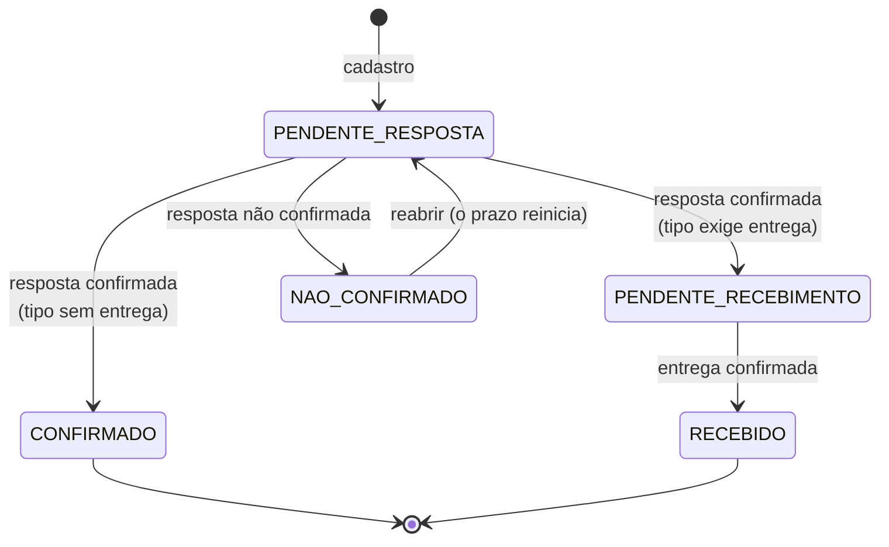

# Regras de negócio

As regras que o sistema aplica. Cada uma está implementada no back-end (`backend/app/services/`) e coberta por testes
em `backend/tests/`.

## Status e caminho do ofício

| Status | Nome na tela | Significado |
|---|---|---|
| `PENDENTE_RESPOSTA` | Pendente de resposta | Aguardando a resposta do destinatário. Todo ofício novo começa aqui |
| `PENDENTE_RECEBIMENTO` | Pendente de recebimento | Resposta confirmada, mas os itens ou o serviço ainda não foram entregues |
| `CONFIRMADO` | Confirmado | Resposta confirmada num tipo que não exige entrega. **Final** |
| `RECEBIDO` | Recebido | Entrega confirmada. **Final** |
| `NAO_CONFIRMADO` | Não confirmado | A resposta não foi confirmada. Pode ser reaberto |

- **Concluídos** (no painel) = recebidos + confirmados.
- Reabrir (`NAO_CONFIRMADO → PENDENTE_RESPOSTA`) faz o prazo recomeçar no dia da reabertura. O histórico guarda cada
  ciclo.
- Mudar o tipo de um ofício já confirmado faz ele entrar na etapa de entrega ou sair dela, conforme o novo tipo. A
  mudança fica no histórico.

## Prazo em dias úteis

- **Dias úteis:** de segunda a sexta, menos os feriados cadastrados em **Feriados**.
- **Início:** o prazo de resposta conta a partir da data do ofício, ou do dia da reabertura. O prazo de entrega conta
  a partir da data da resposta.
- **Alerta** (só para pendentes; é calculado na hora, não fica gravado):

  | Dias úteis | Nível |
  |---|---|
  | 0 a 29 | No prazo (`NORMAL`) |
  | 30 a 44 | Atenção (`ATENCAO`) |
  | 45 ou mais | Crítico (`CRITICO`) |

  Os limites vêm de `DIAS_ATENCAO` e `DIAS_CRITICO` no `.env`. Depois de mudar, é preciso reiniciar o sistema.
- **Tempos registrados:** cada ofício guarda o tempo da resposta ("respondido em X dias úteis") e o da entrega
  ("entregue em Y dias úteis"). O painel usa esses valores nos tempos médios.

## Tipos de ofício

- **Obrigatório:** todo ofício tem um tipo.
- **Cadastro:** feito em **Tipos de ofício** (administrador e master), com nome, nome curto (usado na lista e nos
  gráficos), *exige entrega*, ativo e ordem.
- **Tipos iniciais:**

  | Tipo | Exige entrega |
  |---|---|
  | Equipamentos | Sim |
  | Peças para Manutenção/Engenharia Clínica | Sim |
  | EPI's | Sim |
  | Serviços | Sim |
  | Mobiliários | Sim |
  | Instrumentais | Sim |
  | Outros | Sim |
  | Comunicados | Não |

- **Mudar *exige entrega*:** ajusta os ofícios do tipo que já foram respondidos (entram na etapa de recebimento ou
  saem dela), e cada ajuste fica no histórico.
- **Tipo em uso:** não pode ser apagado, só desativado. Um tipo desativado some do cadastro de ofícios novos e
  continua nos antigos.

## Destinatário e protocolo

- Destinatário é opcional: **SES** + setor, **ACQUA** + setor, ou **Outros** + destino.
- Ao digitar o setor, o sistema sugere os já usados. Grafias diferentes do mesmo setor ("Almoxarifado central" e
  "almoxarifado central") viram uma sugestão só. Um cliente vê sugestões só dos próprios ofícios.
- Protocolo é opcional. **Protocolo** e **número/ano** são únicos **por cliente**.

## Documentos (anexos)

- **Por ofício:** 1 **documento do ofício** e 1 **documento de referência**. Enviar de novo substitui o anterior.
- **Evidência da resposta:** ao registrar a resposta, um documento opcional fica ligado àquele evento do histórico.
  Cada ciclo guarda o seu. O dono do ofício e os administradores podem anexar depois, mesmo com o ofício confirmado.
- **Comprovante de entrega:** opcional, fica ligado ao evento de recebimento.
- **Arquivos aceitos:** PDF, PNG, JPG, DOC, DOCX e ODT, até `UPLOAD_MAX_MB` (20 MB).
- **Armazenamento:** os arquivos ficam em `backend/storage/` com nome aleatório. O banco guarda nome original,
  tamanho e hash SHA-256.

### Lixeira

- Substituir ou remover um documento guarda a versão anterior na **lixeira**. O arquivo continua no disco.
- Administradores e masters podem **visualizar**, **baixar**, **restaurar** (a versão volta para o ofício e a que
  estava no lugar vai para a lixeira) ou **apagar de vez**. Isso pode ser feito no próprio ofício ou na página
  **Arquivos**.
- Excluir um ofício apaga também as versões dele que estão na lixeira.

### Verificação dos arquivos

- O sistema verifica os arquivos ao ligar (1 minuto depois) e depois a cada `VERIFICACAO_HORAS` (24). Também
  verifica quando alguém abre **Arquivos** ou clica em *Verificar agora*.
- Para cada documento, inclusive os da lixeira, confere se o arquivo **existe** e se o **hash** é o mesmo do envio.
- Se houver problema, aparece um contador vermelho no menu **Arquivos** e um registro no log.

## Perfis

| Perfil | Pode |
|---|---|
| `CLIENTE` | Tudo nos **próprios** ofícios, inclusive nos confirmados. Para excluir, **pede a um administrador** |
| `ADMIN` | Ver e alterar todos os ofícios, excluir direto, aprovar ou recusar pedidos de exclusão, gerenciar clientes, feriados e tipos, usar a lixeira e a verificação de arquivos, fazer correções |
| `MASTER` | Tudo do administrador, e também criar e alterar administradores e masters. Sempre resta pelo menos 1 master ativo |

## Correções (administrador e master)

- Corrigir o resultado, a data e a observação da resposta atual.
- Corrigir a data e a observação do recebimento.
- Desfazer o recebimento ou a resposta, informando o motivo. O prazo não reinicia.
- Remover evidências.

O que foi desfeito continua no histórico, marcado como **desfeito**. A tela do ofício esconde esses eventos por
padrão, e um botão mostra todos.

## Exclusão

- Administrador e master excluem direto (com confirmação).
- O cliente **solicita a exclusão** informando o motivo. O pedido aparece em **Pedidos de exclusão**, com um contador
  no menu dos administradores, que aprovam (o ofício é excluído) ou recusam (o ofício continua). O cliente pode
  cancelar o pedido enquanto ele estiver pendente.
- Excluir apaga o ofício, os documentos e as versões da lixeira. O registro da exclusão continua em **Atividades**.

## Login e sessão

- **Duração:** a sessão dura `JWT_EXPIRA_MINUTOS` (480 = 8 horas).
- **Bloqueio:** depois de `LOGIN_MAX_TENTATIVAS` (5) senhas erradas seguidas, aquele login fica bloqueado por
  `LOGIN_BLOQUEIO_MINUTOS` (5) naquele computador. O bloqueio é por login + endereço de rede, para que um computador
  não bloqueie os outros.
- **Troca de senha:** encerra todas as sessões abertas do usuário, em qualquer computador. A tela de login explica o
  motivo.

## Atividades (auditoria)

Toda alteração fica registrada na conta de quem a fez: o quê, quando e o valor antigo → novo. Isso inclui cadastro,
edição, status, anexos, correções, exclusões, pedidos, usuários, feriados, tipos e lixeira. Administradores veem
tudo; clientes veem o que fizeram e o que foi feito nos próprios ofícios.

## Feriados

- `scripts.inicializar` e o botão de feriados nacionais (`POST /api/feriados/nacionais/{ano}`) cadastram os feriados
  nacionais do ano, incluindo Carnaval e Corpus Christi como dias sem expediente.
- Feriados estaduais, municipais e pontos facultativos são cadastrados um a um em **Feriados**.
- **Todo ano novo:** gere os feriados nacionais do ano, senão o prazo vai contar esses dias como úteis.
