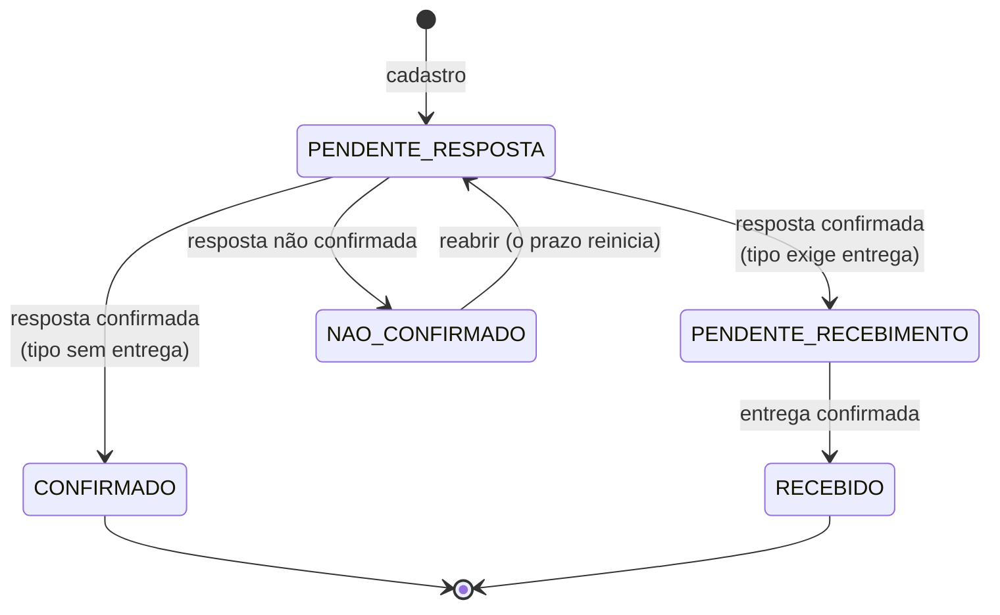

# Regras de negócio

As regras que o sistema aplica. Cada uma está implementada no back-end (`backend/app/services/`) e coberta por testes
em `backend/tests/`.

## Status e caminho do ofício

| Status | Nome na tela | Significado |
|---|---|---|
| `PENDENTE_RESPOSTA` | Pendente de resposta | Aguardando a resposta do destinatário. Todo ofício novo começa aqui |
| `PENDENTE_RECEBIMENTO` | Pendente de recebimento | Resposta confirmada, mas os itens ou o serviço ainda não foram entregues |
| `CONFIRMADO` | Confirmado | Resposta confirmada num tipo que não exige entrega. **Final** |
| `RECEBIDO` | Recebido | Entrega confirmada. **Final** |
| `NAO_CONFIRMADO` | Não confirmado | A resposta não foi confirmada. Pode ser reaberto |

- **Concluídos** (no painel) = recebidos + confirmados.
- Reabrir (`NAO_CONFIRMADO → PENDENTE_RESPOSTA`) faz o prazo recomeçar no dia da reabertura. O histórico guarda cada
  ciclo.
- Mudar o tipo de um ofício já confirmado faz ele entrar na etapa de entrega ou sair dela, conforme o novo tipo. A
  mudança fica no histórico.

## Prazo em dias corridos

- **Dias corridos:** todos os dias contam, inclusive sábados, domingos e feriados (desde a versão 2.2;
  antes eram dias úteis). O dia do início não conta: um ofício de 15/10 tem 5 dias em 20/10.
- **Início:** o prazo de resposta conta a partir da data do ofício, ou do dia da reabertura. O prazo de entrega conta
  a partir da data da resposta.
- **Alerta** (só para pendentes; é calculado na hora, não fica gravado):

  | Dias corridos | Nível |
  |---|---|
  | 0 a 29 | No prazo (`NORMAL`) |
  | 30 a 44 | Atenção (`ATENCAO`) |
  | 45 ou mais | Crítico (`CRITICO`) |

  Os limites vêm de `DIAS_ATENCAO` e `DIAS_CRITICO` no `.env`. Depois de mudar, é preciso reiniciar o sistema.
- **Tempos registrados:** cada ofício guarda o tempo da resposta ("respondido em X dias") e o da entrega
  ("entregue em Y dias"). O painel usa esses valores nos tempos médios.

## Tipos de ofício

- **Obrigatório:** todo ofício tem um tipo.
- **Cadastro:** feito em **Tipos de ofício** (administrador e master), com nome, nome curto (usado na lista e nos
  gráficos), *exige entrega*, ativo e ordem.
- **Tipos iniciais:**

  | Tipo | Exige entrega |
  |---|---|
  | Equipamentos | Sim |
  | Peças para Manutenção/Engenharia Clínica | Sim |
  | EPI's | Sim |
  | Serviços | Sim |
  | Mobiliários | Sim |
  | Instrumentais | Sim |
  | Outros | Sim |
  | Comunicados | Não |

- **Mudar *exige entrega*:** ajusta os ofícios do tipo que já foram respondidos (entram na etapa de recebimento ou
  saem dela), e cada ajuste fica no histórico.
- **Tipo em uso:** não pode ser apagado, só desativado. Um tipo desativado some do cadastro de ofícios novos e
  continua nos antigos.

## Destinatário e protocolo

- Destinatário é opcional: **SES** + setor, **ACQUA** + setor, ou **Outros** + destino.
- Ao digitar o setor, o sistema sugere os já usados. Grafias diferentes do mesmo setor ("Almoxarifado central" e
  "almoxarifado central") viram uma sugestão só. Um cliente vê sugestões só dos próprios ofícios.
- Protocolo é opcional. **Protocolo** e **número/ano** são únicos **por cliente**.

## Documentos (anexos)

- **Por ofício:** 1 **documento do ofício** e 1 **documento de referência**. Enviar de novo substitui o anterior.
- **Evidência da resposta:** ao registrar a resposta, um documento opcional fica ligado àquele evento do histórico.
  Cada ciclo guarda o seu. O dono do ofício e os administradores podem anexar depois, mesmo com o ofício confirmado.
- **Comprovante de entrega:** opcional, fica ligado ao evento de recebimento.
- **Arquivos aceitos:** PDF, PNG, JPG, DOC, DOCX e ODT, até `UPLOAD_MAX_MB` (20 MB).
- **Armazenamento:** os arquivos ficam em `backend/storage/` com nome aleatório. O banco guarda nome original,
  tamanho e hash SHA-256.

### Lixeira

- Substituir ou remover um documento guarda a versão anterior na **lixeira**. O arquivo continua no disco.
- Administradores e masters podem **visualizar**, **baixar**, **restaurar** (a versão volta para o ofício e a que
  estava no lugar vai para a lixeira) ou **apagar de vez**. Isso pode ser feito no próprio ofício ou na página
  **Arquivos**.
- Excluir um ofício apaga também as versões dele que estão na lixeira.

### Verificação dos arquivos

- O sistema verifica os arquivos ao ligar (1 minuto depois) e depois a cada `VERIFICACAO_HORAS` (24). Também
  verifica quando alguém abre **Arquivos** ou clica em *Verificar agora*.
- Para cada documento, inclusive os da lixeira, confere se o arquivo **existe** e se o **hash** é o mesmo do envio.
- Se houver problema, aparece um contador vermelho no menu **Arquivos** e um registro no log.

## Módulos e perfis

A plataforma é dividida em **módulos**: **Planner de Ofícios**, **Manutenção Clínica**, **Controle de Tetos** e **Documentos**. Cada pessoa é habilitada
nos módulos no cadastro (feito por um administrador ou pelo master) e tem **um papel em cada módulo**. Quem não foi
habilitado num módulo não o abre (as rotas dele respondem `403`).

- **O papel vale por módulo.** Quem é administrador de um módulo **não é** administrador do outro: pode ser
  administrador no Planner e cliente na Manutenção.
- **O master** tem acesso e poder de administrador em **todos** os módulos. É a única conta que enxerga e edita os dois.
- **Depois do login**, quem tem mais de um módulo escolhe qual abrir. Quem tem um só entra direto nele.

| Papel no módulo | Pode |
|---|---|
| `CLIENTE` | No Planner: tudo nos **próprios** ofícios, inclusive nos confirmados; para excluir, **pede a um administrador** |
| `ADMIN` | No Planner: ver e alterar todos os ofícios, excluir direto, aprovar ou recusar pedidos de exclusão, gerenciar feriados e tipos, usar a lixeira e a verificação de arquivos, fazer correções. Em qualquer módulo: **habilitar clientes** naquele módulo |
| `MASTER` (global) | Tudo do administrador, em todos os módulos, e também criar e alterar administradores e masters. Sempre resta pelo menos 1 master ativo |

### Quem gerencia o acesso

- O **administrador de um módulo** cria usuários (sempre como **cliente**) e habilita ou retira pessoas **só nesse
  módulo**. Não toca no acesso dos outros módulos.
- Só altera **nome, login, senha e situação** de quem usa apenas módulos que ele administra. Assim, o administrador
  de um módulo não assume a conta de alguém que também usa outro módulo.
- Não cria nem altera administradores e masters: isso é do **master**.
- Ninguém muda o próprio acesso nem se desativa.
- A mudança de acesso vale **na hora**, sem a pessoa precisar sair e entrar de novo, e fica em **Atividades**.

## Manutenção Clínica (helpdesk)

O operacional abre um **chamado** para uma empresa técnica, e o técnico dessa empresa tem um prazo em **horas corridas**
para dar o **diagnóstico**.

### Papéis no módulo

| Papel | Pode |
|---|---|
| Operacional (`CLIENTE`) | Abrir chamados, ver e acompanhar **todos** os chamados, comentar e anexar arquivos, cancelar (em aberto) e reabrir (concluído) |
| Técnico (`TECNICO`) | Ver só os chamados da **empresa dele**, assumir, comentar, registrar o diagnóstico (**relatório externo** e/ou **relatório técnico** no modelo do sistema), editá-lo depois e concluir |
| Administrador (`ADMIN`) e master | Tudo isso em todos os chamados, e cadastrar as **empresas técnicas** |

O técnico é um usuário como os outros, cadastrado em **Usuários**: perfil *Técnico* na Manutenção Clínica e a
empresa dele. O administrador do módulo cadastra operacionais e técnicos.

### Empresas técnicas

- **Iniciais:** MSI, REALIZA PREDIAL e REALIZA CLIMATIZAÇÃO, cada uma com prazo de 24 horas corridas.
- **Cadastro:** em **Empresas técnicas**, o administrador inclui, renomeia, muda o prazo ou desativa uma empresa.
- **Mudança de prazo:** vale para os chamados **abertos depois** da mudança.
- **Exclusão:** uma empresa com chamados ou técnicos não pode ser excluída, só desativada. Desativada, ela não
  recebe chamados novos.

### Chamado

- **Abertura:** empresa, título, descrição do problema, **data e hora do problema**, local e equipamento (opcionais)
  e uma foto ou documento (opcional).
- **Status:** `ABERTO` → `EM_ATENDIMENTO` (o técnico assumiu ou respondeu) → `CONCLUIDO`. Também pode ir para
  `CANCELADO`, pelo operacional ou administrador, com motivo, enquanto está em aberto.
- **Reabrir:** um chamado concluído pode ser reaberto pelo operacional ou administrador, com motivo.
- **Concluir:** só depois do diagnóstico.
- **Linha do tempo:** guarda tudo (abertura, comentários, respostas técnicas, relatórios, conclusão, reabertura,
  cancelamento), com autor e hora. Nada é apagado.

### Prazo do diagnóstico (horas corridas)

- **Contagem:** começa na **abertura** do chamado e conta todas as horas, inclusive noites, fins de semana e feriados
  (desde a versão 2.2; antes era só o expediente dos dias úteis). 24 h = 1 dia corrido.
  - Exemplo: com 24 h, um chamado aberto na sexta às 15:00 vence no sábado às 15:00.
  - A migração 0016 refez o prazo dos chamados que já existiam com essa regra.
- **O que conta como diagnóstico:** o **primeiro** registro da seção *Diagnóstico técnico*: o relatório externo
  (arquivo da empresa, com resumo opcional) ou o relatório técnico no modelo do sistema (que pode levar o arquivo
  externo junto). Comentar ou assumir não conta.
- **Complementos:** registros técnicos depois do diagnóstico (com o chamado em aberto). Não mudam a data do
  diagnóstico e não podem ser anteriores a ela.
- **Data e hora do diagnóstico:** são as informadas por quem registra, não as do registro. O laudo externo pode
  chegar depois: o técnico informa quando diagnosticou de fato.
  - No relatório externo, o campo *Data e hora do diagnóstico* (padrão: agora).
  - No relatório técnico, a *data e hora do atendimento*.
  - Limites: não antes da abertura do chamado, não no futuro e, se concluído, não depois da conclusão.
- **Edição:** o técnico da empresa ou o administrador edita qualquer registro técnico em **Editar**, na seção
  *Diagnóstico técnico*, enquanto o chamado não estiver cancelado (também depois de concluído).
  - **Data e hora:** no diagnóstico, o prazo e, se o chamado estiver concluído, o tempo de solução são recalculados.
    No relatório do sistema, a data do atendimento (e o PDF) acompanha.
  - **Conteúdo:** o resumo do relatório externo, ou os campos do relatório do sistema.
  - **Relatório externo:** anexar ou substituir. O arquivo anterior não é apagado: passa para o registro da correção
    na linha do tempo, de onde pode ser baixado.
  - Cada edição entra na linha do tempo como *Correção*, com o que mudou, o autor e o motivo (opcional).
  - O arquivo externo anexado por quem registrou, nos 10 minutos seguintes ao registro, conta como parte dele e não
    gera correção.
  - O operacional não edita.
- **Situação**, calculada na hora:

  | Situação | Quando |
  |---|---|
  | No prazo | Sem diagnóstico, com mais de `MANUTENCAO_ALERTA_HORAS` (4) h restantes |
  | Vencendo | Sem diagnóstico, com até 4 h restantes |
  | Atrasado | Sem diagnóstico, prazo vencido |
  | Diagnóstico no prazo / com atraso | Diagnosticado antes ou depois do prazo |

- **Painel:** mostra, por empresa, os chamados em aberto e atrasados, a porcentagem de diagnósticos no prazo, o tempo
  médio até o diagnóstico e o tempo médio de solução.

### Tempo de solução

- **O que é:** o tempo entre o **diagnóstico** e a **conclusão**, gravado no chamado quando ele é concluído, em horas
  corridas. Também fica escrito na linha do tempo, junto da conclusão.
- **Durante o atendimento:** o chamado mostra há quanto tempo está em execução desde o diagnóstico.
- **Reabertura:** apaga o tempo gravado. A nova conclusão grava de novo, contando desde o diagnóstico original.

### Quadro de acompanhamento

- **Painel do técnico:** é a tela inicial do técnico. Mostra os chamados da empresa dele por etapa:

  | Coluna | Chamados |
  |---|---|
  | Aguardando diagnóstico | Ainda sem diagnóstico; o mais perto do vencimento primeiro |
  | Em execução | Diagnosticados, com o serviço em andamento e há quanto tempo |
  | Aguardando peças / equipamentos | Com solicitação no Planner ainda não entregue |
  | Concluídos | Dos últimos 7, 30 ou 90 dias, com o tempo de solução |

- **Indicadores:** em aberto, atrasados, aguardando peças, % de diagnósticos no prazo e tempo médio de solução no
  período.
- **Filtro:** *Só os meus* mostra os chamados que o técnico assumiu ou respondeu.
- **Outros papéis:** operacionais e administradores usam o mesmo quadro, em **Quadro de acompanhamento**, com filtro
  por empresa.

### Solicitação de peças ou equipamentos (Planner de Ofícios)

- **Quem:** o operacional ou o administrador, com o chamado em aberto, clica em **Solicitar peças ou equipamentos**.
- **Formulário:** tipo (Peças para Manutenção/Engenharia Clínica ou Equipamentos), nº e data do ofício, protocolo,
  destinatário e os itens solicitados.
- **Resultado:** o sistema cadastra um **ofício no Planner de Ofícios**, ligado ao chamado.
  - Ele fica em nome de quem pediu e segue as regras e os prazos normais do Planner (resposta e entrega).
  - A observação traz o chamado e os itens.
  - O número e o protocolo seguem a mesma regra de unicidade dos outros ofícios.
- **Documento:** é anexado **no Planner**, no próprio ofício (documento do ofício, de referência, evidência da
  resposta, comprovante de entrega). O chamado tem o atalho *Anexar o documento no Planner de Ofícios*.
- **Espelho no chamado:** tudo o que é feito no Planner com esse ofício aparece no chamado.
  - **Documentos:** listados na seção **Peças e equipamentos**. Quem vê o chamado, inclusive o técnico, pode baixá-los
    por ali.
  - **Status e datas:** resposta, entrega, correções, desfazer e exclusão do ofício.
  - **Linha do tempo:** cada uma dessas ações entra como *Planner de Ofícios · …*, com o autor.
- **Quadro:** o chamado fica em *Aguardando peças* enquanto o ofício estiver pendente de resposta ou de entrega.
  - Com a entrega registrada no Planner, ele volta sozinho para a etapa em que estava.
  - O cartão mostra o status de cada ofício.
  - O quadro e o chamado se atualizam a cada 30 segundos.
- **No Planner:** o ofício mostra o **chamado** a que está ligado.

### Vincular um ofício que já existe no Planner

- **Quem:** o operacional ou o administrador, com o chamado em aberto, clica em **Vincular ofício existente**.
- **Quais ofícios:** os que a pessoa vê no Planner e que ainda não têm chamado.
  - Cliente do Planner: só os próprios ofícios.
  - Administrador do Planner e master: os de todos os clientes.
  - Vale qualquer tipo e qualquer status. Ofício de outro cliente responde "não encontrado".
- **Um chamado por ofício:** vincular um ofício que já está em outro chamado é recusado (`409`). É preciso
  desvincular de lá antes.
- **Depois do vínculo:** o ofício se comporta como uma solicitação feita pelo chamado.
  - Os documentos e o andamento que ele já tinha aparecem no chamado.
  - Vale o espelho: o que for feito no Planner entra na linha do tempo do chamado.
  - Se estiver pendente de resposta ou de entrega, o chamado vai para *Aguardando peças*.
- **Desvincular:** o dono do ofício ou um administrador (da Manutenção ou do Planner), com o chamado em aberto. O
  ofício continua no Planner, sem alteração, e pode ser vinculado de novo.
- **Registro:** o vínculo e a desvinculação entram na linha do tempo do chamado e nas atividades do ofício.

### Operacional e o Planner de Ofícios

- **Regra:** todo operacional da Manutenção Clínica (cliente ou administrador do módulo) também tem acesso ao
  **Planner de Ofícios**.
- **Concessão automática:** quem é habilitado como operacional e ainda não tinha o Planner ganha acesso de **cliente**
  automaticamente, mesmo quando quem cadastra é o administrador da Manutenção.
- **Papéis independentes:** pode ser administrador em um módulo e cliente no outro.
- **Retirada:** o Planner não pode ser retirado de um operacional (`400`). Para isso, primeiro mude o papel dele na
  Manutenção.
- **Técnicos:** os técnicos das empresas usam só a Manutenção Clínica.
- **Gestão da conta:** o acesso de cliente ao Planner que vem com o operacional não impede o administrador da
  Manutenção de gerir a conta dele.

### Relatório técnico

- **Modelo do sistema:** data e hora do atendimento, equipamento, patrimônio/nº de série, situação do equipamento,
  diagnóstico, causa provável, serviço executado, peças e materiais, e recomendações.
- **PDF:** gera um PDF com os dados do chamado, do atendimento e espaço para as assinaturas.
- **Arquivo externo:** quando a empresa usa um laudo próprio, ele é o *relatório externo* do diagnóstico, ou vai
  anexado ao relatório do sistema, no mesmo registro.
- **Arquivos aceitos:** os mesmos dos ofícios (PDF, imagens, Word, ODT, até `UPLOAD_MAX_MB`).

### Manutenção preventiva

- **Plano:** uma rotina de uma empresa técnica, com o escopo e a periodicidade ("a cada N dias, semanas ou meses").
  Só o administrador do módulo cria e altera planos. A periodicidade é decisão da unidade, porque o contrato prevê a
  preventiva sem fixar os períodos.
- **Datas:** cada data prevista do plano é uma **preventiva**.
  - Contam a partir da primeira. Nos planos em meses, mantêm o dia do início (ou o último dia do mês).
  - São criadas com 90 dias de antecedência e completadas quando as telas são abertas. Sempre existe a próxima.
  - Um plano novo pode começar até 60 dias atrás, para registrar o que já venceu.
- **Mudança de periodicidade:** refaz só as preventivas ainda programadas de hoje em diante. As vencidas e as já
  registradas ficam como estão. Desativar o plano retira as programadas futuras.
- **Exclusão:** só de plano sem nada vencido ou registrado. Nos outros casos, desativa-se.
- **Tolerância:** a preventiva conta como feita no prazo até `tolerancia_dias` dias corridos depois da data prevista
  (padrão do plano: 5).
- **Situação**, calculada na hora:

  | Situação | Regra |
  |---|---|
  | Programada | Faltam mais de 7 dias para a data prevista |
  | Para realizar agora | Faltam 7 dias ou menos, ou a data passou e ainda está na tolerância |
  | Atrasada | Passou da tolerância sem registro |
  | Realizada no prazo | Data da realização até o fim da tolerância |
  | Realizada com atraso | Data da realização depois da tolerância |
  | Não realizada | Marcada por quem fiscaliza, com motivo |

- **Realização:** o técnico da empresa, o operacional ou o administrador registra a data (não futura, e no máximo
  90 dias antes da prevista), quem executou, o que foi feito e a evidência em arquivo (opcional).
- **Ateste:** só o operacional ou o administrador atestam. O técnico não atesta o serviço da própria empresa.
  Depois do ateste, o registro não pode ser desfeito.
- **Não realizada:** o operacional ou o administrador, com motivo, e só depois que a data prevista chega.
- **Desfazer registro:** só o administrador, e só antes do ateste. A evidência anexada é apagada junto.
- **Visibilidade:** o técnico vê só os planos e as preventivas da empresa dele.
- **Cumprimento por empresa:** realizadas ÷ (realizadas + atrasadas + não realizadas) no período. As programadas que
  ainda não venceram não entram na conta.

### Avisos internos

- O servidor não envia e-mail. Os avisos ficam no menu **Avisos**, com o número de pendências críticas e de atenção.
- São calculados na hora, sem marcação de lido: o aviso some quando a pendência é resolvida.
- **Críticos:** chamados com o diagnóstico atrasado e preventivas atrasadas.
- **Atenção:** chamados com o prazo vencendo, preventivas para realizar agora e, para quem fiscaliza, preventivas
  realizadas aguardando ateste.
- O técnico recebe só o que é da empresa dele, e também vê quantos chamados aguardam o diagnóstico.

### Unidade

Cada unidade tem o próprio servidor. O nome da unidade vem do `.env` (`UNIDADE_NOME` e `UNIDADE_DESCRICAO`) e
aparece no login, no menu e no PDF do relatório técnico. Sem a configuração, nada aparece.

## Controle de Tetos

### Papéis

| Papel | Pode |
|---|---|
| Usuário do setor (`CLIENTE`, com `setor_id`) | Ver os tipos e indicadores **do próprio setor**, lançar gastos nele e corrigir ou excluir os lançamentos do setor. Sem setor, o módulo pede para o administrador ligar o usuário a um |
| Administrador (`ADMIN`) e master | Criar setores e tipos, definir e remover valores de teto, ver todos os setores e lançar em qualquer um |

O setor é escolhido no cadastro do usuário (acesso ao Controle de Tetos). É obrigatório para o usuário do setor.

### Tipo de teto e valor

- O tipo pertence a um setor e tem nome (único no setor), unidade (R$ por padrão, ou litros, resmas, kWh…) e o
  **% de alerta** (padrão 80%).
- O valor fica nas **vigências**: período base (diário, mensal ou anual), valor e a data a partir da qual vale.
  - Um novo valor vale a partir da data dele; os dias anteriores continuam com o valor que valia neles.
  - Na mesma data de uma vigência existente, o valor dela é substituído.
  - A **primeira** vigência vale também para os dias anteriores a ela.
  - O tipo sempre tem pelo menos uma vigência.
- Tipo com lançamentos não se exclui (desative). Desativado, sai do painel e não recebe lançamentos.

### Teto de cada período (proporção)

O teto de um dia sai da vigência do dia:

- diário: o valor;
- mensal: valor ÷ dias do mês;
- anual: (valor ÷ 12) ÷ dias do mês.

O teto de um mês, de um ano ou do 1º dia do mês até hoje é a **soma dos tetos dos dias**. Assim, um teto mensal de
R$ 3.000 dá R$ 3.000 em qualquer mês, um anual de R$ 12.000 dá R$ 1.000 em qualquer mês e R$ 12.000 no ano, e um
diário de R$ 50 dá R$ 1.550 num mês de 31 dias.

### Lançamento

- Data não futura, valor maior que zero com até duas casas decimais (na unidade do tipo), descrição obrigatória;
  documento e comprovante opcionais.
- Corrigir, trocar o comprovante e excluir ficam nas **Atividades**, com o antes e o depois.

### Situação e projeção

- **Acima do teto:** o gasto passou do teto do período. **Atenção:** chegou ao % de alerta do tipo. **Dentro do
  teto:** abaixo do alerta.
- A situação do cartão é a do **mês**. Os medidores do dia e do ano têm a situação deles.
- **Projeção do mês** (só no mês corrente): gasto até hoje ÷ dias decorridos × dias do mês. Se passar do teto do mês,
  o tipo conta como atenção no painel, mesmo abaixo do % de alerta.
- Os totais de um setor somam só tipos da **mesma unidade**.

## Correções (administrador e master)

- Corrigir o resultado, a data e a observação da resposta atual.
- Corrigir a data e a observação do recebimento.
- Desfazer o recebimento ou a resposta, informando o motivo. O prazo não reinicia.
- Remover evidências.

O que foi desfeito continua no histórico, marcado como **desfeito**. A tela do ofício esconde esses eventos por
padrão, e um botão mostra todos.

## Exclusão

- Administrador e master excluem direto (com confirmação).
- O cliente **solicita a exclusão** informando o motivo. O pedido aparece em **Pedidos de exclusão**, com um contador
  no menu dos administradores, que aprovam (o ofício é excluído) ou recusam (o ofício continua). O cliente pode
  cancelar o pedido enquanto ele estiver pendente.
- Excluir apaga o ofício, os documentos e as versões da lixeira. O registro da exclusão continua em **Atividades**.

## Documentos gerados (ofícios e memorandos)

- **Modelo:** o PDF segue os modelos da unidade. Cabeçalho do documento e assinaturas em Arial 12; corpo em Times New
  Roman 12, justificado, espaçamento 1,5, recuo na 1ª linha de 1,75 cm (ofício) ou 1,25 cm (memorando); margens de
  3 cm nas laterais e 2,5 cm em cima e embaixo; páginas numeradas a partir da 2ª.
- **Situações:** *rascunho* (só quem elaborou edita; sem número; o PDF sai marcado "RASCUNHO") → *emitido* (número,
  data, código e hash; nada mais muda) → *cancelado* (com motivo; o PDF sai marcado "CANCELADO").
- **Numeração:** sequencial por pessoa, tipo e ano, dada só na emissão (rascunho descartado não abre buraco). O
  ofício continua a numeração que a pessoa já usa no Planner (o maior número do ano + 1, no formato `012/2026`); o
  memorando tem a sua (`07/2026`).
- **Para emitir:** assunto e texto; no ofício, o nome do destinatário (e o tipo de ofício, se for registrado no
  Planner); no memorando, De e Para;
  o cargo de quem elaborou e, havendo De acordo, o cargo de quem valida.
- **Módulo e papéis:** *Redator* redige, emite e assina os seus; *Administrador* também vê todos, cancela e cuida do
  timbrado. O De acordo só pode ser dado por quem tem o módulo.
- **Integração com o Planner:** com *registrar no Planner* (padrão para quem usa o Planner; impossível para quem não
  usa), a emissão cadastra o ofício em nome de quem elaborou, como pendente de resposta, na data de hoje, com o tipo
  (obrigatório) e o destinatário informados. Cancelar o documento não exclui o ofício do Planner. Quem acompanha o
  ofício no Planner baixa o PDF do documento por lá, mesmo sem o módulo.
- **Assinaturas:** o espaço para assinar à mão sempre sai. A assinatura eletrônica é feita no app por quem elaborou e
  por quem dá o De acordo (se for usuário do sistema), confirmando a senha (as regras de bloqueio do login valem aqui).
  Fica registrado quem, quando e de qual computador. Um administrador vê, mas não assina por ninguém.
- **Verificação:** o código (8 caracteres, sem letras e números que se confundem) e o QR code levam à página pública
  `/verificar`, que mostra só os dados de identificação, nunca o texto. O hash SHA-256 do conteúdo, gravado na
  emissão, é recalculado a cada consulta: se o registro foi mexido, a página avisa.
- **Quem vê:** quem elaborou, quem dá o De acordo e os administradores do módulo.

## Login e sessão

- **Duração:** a sessão dura `JWT_EXPIRA_MINUTOS` (480 = 8 horas).
- **Bloqueio:** depois de `LOGIN_MAX_TENTATIVAS` (5) senhas erradas seguidas, aquele login fica bloqueado por
  `LOGIN_BLOQUEIO_MINUTOS` (5) naquele computador. O bloqueio é por login + endereço de rede, para que um computador
  não bloqueie os outros.
- **Troca de senha:** encerra todas as sessões abertas do usuário, em qualquer computador. A tela de login explica o
  motivo.

## Atividades (auditoria)

Toda alteração fica registrada na conta de quem a fez: o quê, quando e o valor antigo → novo. Isso inclui cadastro,
edição, status, anexos, correções, exclusões, pedidos, usuários, feriados, tipos e lixeira. Administradores veem
tudo; clientes veem o que fizeram e o que foi feito nos próprios ofícios.

## Feriados

- `scripts.inicializar` e o botão de feriados nacionais (`POST /api/feriados/nacionais/{ano}`) cadastram os feriados
  nacionais do ano, incluindo Carnaval e Corpus Christi como dias sem expediente.
- Feriados estaduais, municipais e pontos facultativos são cadastrados um a um em **Feriados**.
- **Desde a versão 2.2 os feriados não entram nos prazos** (todos são em dias corridos). O cadastro continua no
  banco e na API, mas a tela saiu do menu.
