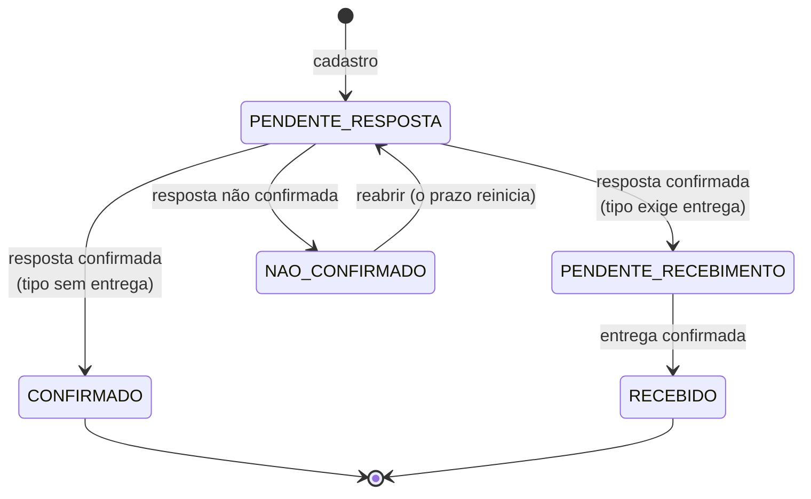

# Regras de negócio

As regras que o sistema aplica. Cada uma está implementada no back-end (`backend/app/services/`) e coberta por testes
em `backend/tests/`.

## Status e caminho do ofício

| Status | Nome na tela | Significado |
|---|---|---|
| `PENDENTE_RESPOSTA` | Pendente de resposta | Aguardando a resposta do destinatário. Todo ofício novo começa aqui |
| `PENDENTE_RECEBIMENTO` | Pendente de recebimento | Resposta confirmada, mas os itens ou o serviço ainda não foram entregues |
| `CONFIRMADO` | Confirmado | Resposta confirmada num tipo que não exige entrega. **Final** |
| `RECEBIDO` | Recebido | Entrega confirmada. **Final** |
| `NAO_CONFIRMADO` | Não confirmado | A resposta não foi confirmada. Pode ser reaberto |

- **Concluídos** (no painel) = recebidos + confirmados.
- Reabrir (`NAO_CONFIRMADO → PENDENTE_RESPOSTA`) faz o prazo recomeçar no dia da reabertura. O histórico guarda cada
  ciclo.
- Mudar o tipo de um ofício já confirmado faz ele entrar na etapa de entrega ou sair dela, conforme o novo tipo. A
  mudança fica no histórico.

## Prazo em dias úteis

- **Dias úteis:** de segunda a sexta, menos os feriados cadastrados em **Feriados**.
- **Início:** o prazo de resposta conta a partir da data do ofício, ou do dia da reabertura. O prazo de entrega conta
  a partir da data da resposta.
- **Alerta** (só para pendentes; é calculado na hora, não fica gravado):

  | Dias úteis | Nível |
  |---|---|
  | 0 a 29 | No prazo (`NORMAL`) |
  | 30 a 44 | Atenção (`ATENCAO`) |
  | 45 ou mais | Crítico (`CRITICO`) |

  Os limites vêm de `DIAS_ATENCAO` e `DIAS_CRITICO` no `.env`. Depois de mudar, é preciso reiniciar o sistema.
- **Tempos registrados:** cada ofício guarda o tempo da resposta ("respondido em X dias úteis") e o da entrega
  ("entregue em Y dias úteis"). O painel usa esses valores nos tempos médios.

## Tipos de ofício

- **Obrigatório:** todo ofício tem um tipo.
- **Cadastro:** feito em **Tipos de ofício** (administrador e master), com nome, nome curto (usado na lista e nos
  gráficos), *exige entrega*, ativo e ordem.
- **Tipos iniciais:**

  | Tipo | Exige entrega |
  |---|---|
  | Equipamentos | Sim |
  | Peças para Manutenção/Engenharia Clínica | Sim |
  | EPI's | Sim |
  | Serviços | Sim |
  | Mobiliários | Sim |
  | Instrumentais | Sim |
  | Outros | Sim |
  | Comunicados | Não |

- **Mudar *exige entrega*:** ajusta os ofícios do tipo que já foram respondidos (entram na etapa de recebimento ou
  saem dela), e cada ajuste fica no histórico.
- **Tipo em uso:** não pode ser apagado, só desativado. Um tipo desativado some do cadastro de ofícios novos e
  continua nos antigos.

## Destinatário e protocolo

- Destinatário é opcional: **SES** + setor, **ACQUA** + setor, ou **Outros** + destino.
- Ao digitar o setor, o sistema sugere os já usados. Grafias diferentes do mesmo setor ("Almoxarifado central" e
  "almoxarifado central") viram uma sugestão só. Um cliente vê sugestões só dos próprios ofícios.
- Protocolo é opcional. **Protocolo** e **número/ano** são únicos **por cliente**.

## Documentos (anexos)

- **Por ofício:** 1 **documento do ofício** e 1 **documento de referência**. Enviar de novo substitui o anterior.
- **Evidência da resposta:** ao registrar a resposta, um documento opcional fica ligado àquele evento do histórico.
  Cada ciclo guarda o seu. O dono do ofício e os administradores podem anexar depois, mesmo com o ofício confirmado.
- **Comprovante de entrega:** opcional, fica ligado ao evento de recebimento.
- **Arquivos aceitos:** PDF, PNG, JPG, DOC, DOCX e ODT, até `UPLOAD_MAX_MB` (20 MB).
- **Armazenamento:** os arquivos ficam em `backend/storage/` com nome aleatório. O banco guarda nome original,
  tamanho e hash SHA-256.

### Lixeira

- Substituir ou remover um documento guarda a versão anterior na **lixeira**. O arquivo continua no disco.
- Administradores e masters podem **visualizar**, **baixar**, **restaurar** (a versão volta para o ofício e a que
  estava no lugar vai para a lixeira) ou **apagar de vez**. Isso pode ser feito no próprio ofício ou na página
  **Arquivos**.
- Excluir um ofício apaga também as versões dele que estão na lixeira.

### Verificação dos arquivos

- O sistema verifica os arquivos ao ligar (1 minuto depois) e depois a cada `VERIFICACAO_HORAS` (24). Também
  verifica quando alguém abre **Arquivos** ou clica em *Verificar agora*.
- Para cada documento, inclusive os da lixeira, confere se o arquivo **existe** e se o **hash** é o mesmo do envio.
- Se houver problema, aparece um contador vermelho no menu **Arquivos** e um registro no log.

## Módulos e perfis

A plataforma é dividida em **módulos**: **Planner de Ofícios** e **Manutenção Clínica**. Cada pessoa é habilitada
nos módulos no cadastro (feito por um administrador ou pelo master) e tem **um papel em cada módulo**. Quem não foi
habilitado num módulo não o abre (as rotas dele respondem `403`).

- **O papel vale por módulo.** Quem é administrador de um módulo **não é** administrador do outro: pode ser
  administrador no Planner e cliente na Manutenção.
- **O master** tem acesso e poder de administrador em **todos** os módulos. É a única conta que enxerga e edita os dois.
- **Depois do login**, quem tem mais de um módulo escolhe qual abrir. Quem tem um só entra direto nele.

| Papel no módulo | Pode |
|---|---|
| `CLIENTE` | No Planner: tudo nos **próprios** ofícios, inclusive nos confirmados; para excluir, **pede a um administrador** |
| `ADMIN` | No Planner: ver e alterar todos os ofícios, excluir direto, aprovar ou recusar pedidos de exclusão, gerenciar feriados e tipos, usar a lixeira e a verificação de arquivos, fazer correções. Em qualquer módulo: **habilitar clientes** naquele módulo |
| `MASTER` (global) | Tudo do administrador, em todos os módulos, e também criar e alterar administradores e masters. Sempre resta pelo menos 1 master ativo |

### Quem gerencia o acesso

- O **administrador de um módulo** cria usuários (sempre como **cliente**) e habilita ou retira pessoas **só nesse
  módulo**. Não toca no acesso dos outros módulos.
- Só altera **nome, login, senha e situação** de quem usa apenas módulos que ele administra. Assim, o administrador
  de um módulo não assume a conta de alguém que também usa outro módulo.
- Não cria nem altera administradores e masters: isso é do **master**.
- Ninguém muda o próprio acesso nem se desativa.
- A mudança de acesso vale **na hora**, sem a pessoa precisar sair e entrar de novo, e fica em **Atividades**.

## Manutenção Clínica (helpdesk)

O operacional abre um **chamado** para uma empresa técnica, e o técnico dessa empresa tem um prazo em **horas úteis**
para dar o **diagnóstico**.

### Papéis no módulo

| Papel | Pode |
|---|---|
| Operacional (`CLIENTE`) | Abrir chamados, ver e acompanhar **todos** os chamados, comentar e anexar arquivos, cancelar (em aberto) e reabrir (concluído) |
| Técnico (`TECNICO`) | Ver só os chamados da **empresa dele**, assumir, comentar, registrar a resposta técnica (texto e/ou **arquivo externo**), fazer o **relatório técnico** no modelo do sistema e concluir |
| Administrador (`ADMIN`) e master | Tudo isso em todos os chamados, e cadastrar as **empresas técnicas** |

O técnico é um usuário como os outros, cadastrado em **Usuários**: perfil *Técnico* na Manutenção Clínica e a
empresa dele. O administrador do módulo cadastra operacionais e técnicos.

### Empresas técnicas

- **Iniciais:** MSI, REALIZA PREDIAL e REALIZA CLIMATIZAÇÃO, cada uma com prazo de 24 horas úteis.
- **Cadastro:** em **Empresas técnicas**, o administrador inclui, renomeia, muda o prazo ou desativa uma empresa.
- **Mudança de prazo:** vale para os chamados **abertos depois** da mudança.
- **Exclusão:** uma empresa com chamados ou técnicos não pode ser excluída, só desativada. Desativada, ela não
  recebe chamados novos.

### Chamado

- **Abertura:** empresa, título, descrição do problema, **data e hora do problema**, local e equipamento (opcionais)
  e uma foto ou documento (opcional).
- **Status:** `ABERTO` → `EM_ATENDIMENTO` (o técnico assumiu ou respondeu) → `CONCLUIDO`. Também pode ir para
  `CANCELADO`, pelo operacional ou administrador, com motivo, enquanto está em aberto.
- **Reabrir:** um chamado concluído pode ser reaberto pelo operacional ou administrador, com motivo.
- **Concluir:** só depois do diagnóstico.
- **Linha do tempo:** guarda tudo (abertura, comentários, respostas técnicas, relatórios, conclusão, reabertura,
  cancelamento), com autor e hora. Nada é apagado.

### Prazo do diagnóstico (horas úteis)

- **Contagem:** começa na **abertura** do chamado e conta só o expediente (`MANUTENCAO_EXPEDIENTE_INICIO` a
  `MANUTENCAO_EXPEDIENTE_FIM`, padrão 08:00–18:00), de segunda a sexta, sem os feriados de **Feriados**.
  - Exemplo: com 24 h úteis e expediente de 10 h, um chamado aberto na sexta às 15:00 vence na quarta às 09:00.
- **O que conta como diagnóstico:** a **primeira** resposta técnica (texto e/ou arquivo externo marcado como
  resposta técnica) ou o primeiro relatório técnico. Comentar ou assumir não conta.
- **Situação**, calculada na hora:

  | Situação | Quando |
  |---|---|
  | No prazo | Sem diagnóstico, com mais de `MANUTENCAO_ALERTA_HORAS` (4) h úteis restantes |
  | Vencendo | Sem diagnóstico, com até 4 h úteis restantes |
  | Atrasado | Sem diagnóstico, prazo vencido |
  | Diagnóstico no prazo / com atraso | Diagnosticado antes ou depois do prazo |

- **Painel:** mostra, por empresa, os chamados em aberto e atrasados, a porcentagem de diagnósticos no prazo, o tempo
  médio até o diagnóstico e o tempo médio de solução.

### Tempo de solução

- **O que é:** o tempo entre o **diagnóstico** e a **conclusão**, gravado no chamado quando ele é concluído, em horas
  úteis (mesmo expediente do prazo) e em horas corridas. Também fica escrito na linha do tempo, junto da conclusão.
- **Durante o atendimento:** o chamado mostra há quanto tempo está em execução desde o diagnóstico.
- **Reabertura:** apaga o tempo gravado. A nova conclusão grava de novo, contando desde o diagnóstico original.

### Quadro de acompanhamento

- **Painel do técnico:** é a tela inicial do técnico. Mostra os chamados da empresa dele por etapa:

  | Coluna | Chamados |
  |---|---|
  | Aguardando diagnóstico | Ainda sem diagnóstico; o mais perto do vencimento primeiro |
  | Em execução | Diagnosticados, com o serviço em andamento e há quanto tempo |
  | Aguardando peças / equipamentos | Com solicitação no Planner ainda não entregue |
  | Concluídos | Dos últimos 7, 30 ou 90 dias, com o tempo de solução |

- **Indicadores:** em aberto, atrasados, aguardando peças, % de diagnósticos no prazo e tempo médio de solução no
  período.
- **Filtro:** *Só os meus* mostra os chamados que o técnico assumiu ou respondeu.
- **Outros papéis:** operacionais e administradores usam o mesmo quadro, em **Quadro de acompanhamento**, com filtro
  por empresa.

### Solicitação de peças ou equipamentos (Planner de Ofícios)

- **Quem:** o operacional ou o administrador, com o chamado em aberto, clica em **Solicitar peças ou equipamentos**.
- **Formulário:** tipo (Peças para Manutenção/Engenharia Clínica ou Equipamentos), nº e data do ofício, protocolo,
  destinatário e os itens solicitados.
- **Resultado:** o sistema cadastra um **ofício no Planner de Ofícios**, ligado ao chamado.
  - Ele fica em nome de quem pediu e segue as regras e os prazos normais do Planner (resposta e entrega).
  - A observação traz o chamado e os itens.
  - O número e o protocolo seguem a mesma regra de unicidade dos outros ofícios.
- **Documento:** é anexado **no Planner**, no próprio ofício (documento do ofício, de referência, evidência da
  resposta, comprovante de entrega). O chamado tem o atalho *Anexar o documento no Planner de Ofícios*.
- **Espelho no chamado:** tudo o que é feito no Planner com esse ofício aparece no chamado.
  - **Documentos:** listados na seção **Peças e equipamentos**. Quem vê o chamado, inclusive o técnico, pode baixá-los
    por ali.
  - **Status e datas:** resposta, entrega, correções, desfazer e exclusão do ofício.
  - **Linha do tempo:** cada uma dessas ações entra como *Planner de Ofícios · …*, com o autor.
- **Quadro:** o chamado fica em *Aguardando peças* enquanto o ofício estiver pendente de resposta ou de entrega.
  - Com a entrega registrada no Planner, ele volta sozinho para a etapa em que estava.
  - O cartão mostra o status de cada ofício.
  - O quadro e o chamado se atualizam a cada 30 segundos.
- **No Planner:** o ofício mostra a **origem**, ou seja, o chamado.

### Operacional e o Planner de Ofícios

- **Regra:** todo operacional da Manutenção Clínica (cliente ou administrador do módulo) também tem acesso ao
  **Planner de Ofícios**.
- **Concessão automática:** quem é habilitado como operacional e ainda não tinha o Planner ganha acesso de **cliente**
  automaticamente, mesmo quando quem cadastra é o administrador da Manutenção.
- **Papéis independentes:** pode ser administrador em um módulo e cliente no outro.
- **Retirada:** o Planner não pode ser retirado de um operacional (`400`). Para isso, primeiro mude o papel dele na
  Manutenção.
- **Técnicos:** os técnicos das empresas usam só a Manutenção Clínica.
- **Gestão da conta:** o acesso de cliente ao Planner que vem com o operacional não impede o administrador da
  Manutenção de gerir a conta dele.

### Relatório técnico

- **Modelo do sistema:** data e hora do atendimento, equipamento, patrimônio/nº de série, situação do equipamento,
  diagnóstico, causa provável, serviço executado, peças e materiais, e recomendações.
- **PDF:** gera um PDF com os dados do chamado, do atendimento e espaço para as assinaturas.
- **Arquivo externo:** quando a empresa usa um laudo próprio, o técnico o anexa na resposta técnica.
- **Arquivos aceitos:** os mesmos dos ofícios (PDF, imagens, Word, ODT, até `UPLOAD_MAX_MB`).

## Correções (administrador e master)

- Corrigir o resultado, a data e a observação da resposta atual.
- Corrigir a data e a observação do recebimento.
- Desfazer o recebimento ou a resposta, informando o motivo. O prazo não reinicia.
- Remover evidências.

O que foi desfeito continua no histórico, marcado como **desfeito**. A tela do ofício esconde esses eventos por
padrão, e um botão mostra todos.

## Exclusão

- Administrador e master excluem direto (com confirmação).
- O cliente **solicita a exclusão** informando o motivo. O pedido aparece em **Pedidos de exclusão**, com um contador
  no menu dos administradores, que aprovam (o ofício é excluído) ou recusam (o ofício continua). O cliente pode
  cancelar o pedido enquanto ele estiver pendente.
- Excluir apaga o ofício, os documentos e as versões da lixeira. O registro da exclusão continua em **Atividades**.

## Login e sessão

- **Duração:** a sessão dura `JWT_EXPIRA_MINUTOS` (480 = 8 horas).
- **Bloqueio:** depois de `LOGIN_MAX_TENTATIVAS` (5) senhas erradas seguidas, aquele login fica bloqueado por
  `LOGIN_BLOQUEIO_MINUTOS` (5) naquele computador. O bloqueio é por login + endereço de rede, para que um computador
  não bloqueie os outros.
- **Troca de senha:** encerra todas as sessões abertas do usuário, em qualquer computador. A tela de login explica o
  motivo.

## Atividades (auditoria)

Toda alteração fica registrada na conta de quem a fez: o quê, quando e o valor antigo → novo. Isso inclui cadastro,
edição, status, anexos, correções, exclusões, pedidos, usuários, feriados, tipos e lixeira. Administradores veem
tudo; clientes veem o que fizeram e o que foi feito nos próprios ofícios.

## Feriados

- `scripts.inicializar` e o botão de feriados nacionais (`POST /api/feriados/nacionais/{ano}`) cadastram os feriados
  nacionais do ano, incluindo Carnaval e Corpus Christi como dias sem expediente.
- Feriados estaduais, municipais e pontos facultativos são cadastrados um a um em **Feriados**.
- **Todo ano novo:** gere os feriados nacionais do ano, senão o prazo vai contar esses dias como úteis.
